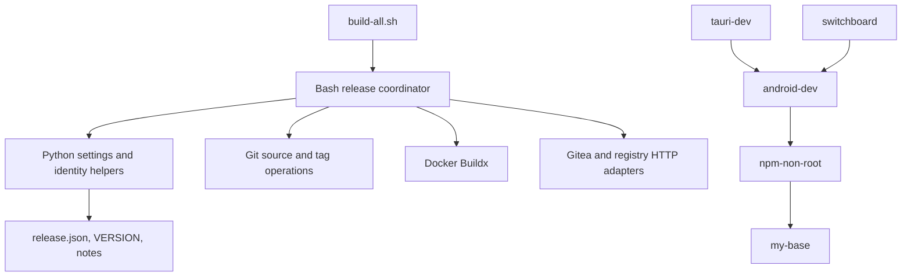

# Brooks-Lint Health Dashboard

- [Dashboard](#dashboard)
- [Module Dependency Graph](#module-dependency-graph)
- [Top Findings](#top-findings)
  - [Warning](#warning)
- [Verification](#verification)
- [Recommendation](#recommendation)

## Dashboard

**Mode:** Health Dashboard

**Scope:** Plan review of `tasks/1-update-build-publish/2-plan.md`, checked against `1-goal.md`, `build-all.sh`, Dockerfile dependencies, and `tests/test_build_all.py`. Scores describe plan readiness, not implemented software or publication safety. Unrelated working-tree changes are excluded.

**Composite Score:** 95/100

**Trend:** First run — no trend data.

- Code Quality: 95/100. One compatibility warning in the proposed change contract.
- Architecture: 90/100. Two warnings concerning publication startup and Buildx driver assumptions.
- Tech Debt: 100/100. No separate finding; the plan recognizes mutable dependencies and excludes unrelated toolchain repair.
- Test Quality: 95/100. One warning concerning native behavior that fake command ports cannot establish.

Balanced scoring deducts five points per warning. Weighted score: `95 × 0.25 + 90 × 0.30 + 100 × 0.25 + 95 × 0.20 = 94.75`, rounded half-up to 95. The proposed plan is the change under review, so the Code Quality dimension is included. No project `.brooks-lint.yaml` or prior history file exists.

**Verdict:** Revise the plan before implementation; its release safeguards are sound in intent, but several operational contracts remain unspecified.

## Module Dependency Graph

Proposed dependencies, not an existing implementation. The release coordinator may legitimately depend on concrete command adapters; this is not itself dependency disorder.

## Top Findings

### Warning

**A1 — Architecture / R5: Build-only assumes loaded images are visible to the builder.**

Symptom: `2-plan.md:38-41` retains default parents such as `my-base:latest` and uses sequential Buildx `--load` builds, while `2-plan.md:34` promises to preserve the caller's builder. A selected `docker-container` or remote builder need not resolve subsequent `FROM` instructions from images loaded into the local Docker image store.

Source: *Clean Architecture* — Dependency Inversion and explicit infrastructure boundaries; *Software Engineering at Google* — Dependency Management.

Consequence: Build-only can build and load the base, then fail on npm or resolve an unintended registry image. `--load` alone does not establish the promised dependency chain.

Remedy: Specify supported build-only builder drivers and image-store behavior. Either require a local Docker driver with an actionable refusal before builds, or define an explicit dependency-context transport that works with the selected builder without registry pushes. Test a container-backed selected builder, a local driver, and the wrong-parent case. State whether caller builder preservation or local-driver selection takes precedence.

**A2 — Architecture / R6: Version aliases lack a complete startup classification.**

Symptom: `2-plan.md:47-50` captures predecessor aliases, publishes an annotated Git tag, and then promotes version and `latest` aliases while refusing version conflicts. It does not explicitly require inventory of all five requested version aliases before staging/tag writes or define a preexisting version alias without a Git tag/release.

Source: *Domain-Driven Design* — Aggregate invariant ownership; *Code Complete* — Defensive Programming and explicit error paths.

Consequence: An already-known conflict can be discovered only after staging images and a Git tag are published. The next invocation then hits the plan's tag-only refusal. Implementers may also disagree about whether a matching preexisting alias is adoption authority.

Remedy: Add a startup state matrix covering the Git tag, release, all version aliases, staging evidence, and all `latest` aliases. Inventory version aliases before publication writes, define exactly when an existing matching alias is acceptable, and refuse foreign aliases before staging. Recheck those conditions before each write and test conflict on the fifth image, not only the first. Keep the acknowledged lack of cross-service atomicity explicit.

**C1 — Code Quality / R2: Compatibility changes are documented but not justified by the requested outcome.**

Symptom: `2-plan.md:21-22,32` removes positional tags, changes credential defaults/overrides, and restricts mode combinations. Existing `build-all.sh:5,18-24,54-55` and its tests exercise those interfaces. The goal requests a reference-based process update, not explicitly their removal.

Source: *Software Engineering at Google* — Hyrum's Law and Backward Compatibility.

Consequence: Existing release commands and credential provisioning stop working even where their behavior can coexist with the new process. Documentation explains breakage but does not determine whether that breakage is necessary or accepted.

Remedy: Add an explicit compatibility decision before implementation. Prefer preserving legacy credential-file/login overrides with documented precedence and accept a positional tag only when it equals the configured version, or obtain approval for removal. List each retained, deprecated, and rejected invocation and its expected behavior; test the migration. Do not silently map a mismatched tag to another release.

**T1 — Test Quality / T6: Native Buildx guarantees have only fake-port acceptance coverage.**

Symptom: `2-plan.md:34,55-60,68-69` requires preservation of Docker routing/plugin discovery and operational dependency builds, but its required verification consists of fake command ports, syntax checks, and local configuration validation. The plan correctly disclaims live proof, yet has no separate gate for native builder/plugin behavior.

Source: *How Google Tests Software* — Risk-based test portfolio; *Working Effectively with Legacy Code* — Sensing and Separation.

Consequence: A suite can pass while real Buildx loses its plugin, switches endpoints, or cannot consume the parent image. The plan's operational acceptance statements would exceed the evidence produced by its mandatory checks.

Remedy: Separate local implementation acceptance from operational readiness. Keep offline stateful fake tests for publication side effects, and specify an opt-in native Buildx smoke checklist for user-authorized execution: config-local plugin discovery, Docker host/context selection, and a minimal two-image parent/child build. No production publication is needed for those checks. If unavailable, report these guarantees as unverified rather than passed; do not install dependencies or run the smoke checks during this review.

## Verification

- Existing suite map: one Python test module, four test methods, exercising the shell entry point through fake Git/Docker commands; no native Docker integration or E2E tests. Proposed test counts cannot be established before implementation.
- Ran `python3 -B -m unittest discover -s tests -v`: failed with four failure instances across two test methods. The release test expects four builds but receives five; each of three build-only remote-form subtests expects five total calls but receives six. Failure-stop/cleanup and invalid-input tests pass.
- These are preexisting stale-count failures already identified in `2-plan.md:55`, not additional deductions or evidence that the proposed implementation fails.
- No real builds, credential reads, publication operations, or implementation edits occurred. Existing fakes remain appropriate for observing command-side effects; their use alone is not mock abuse.

## Recommendation

Update `2-plan.md` to resolve A1 and A2 before coding, record the compatibility decision in C1, and split local acceptance from native verification as T1 requests. Preserve the plan's strongest choices: committed-source builds, digest-bound parents, all-five-image verification, explicit AMD64 scope, and no automatic rollback. Architecture needs the most attention; a focused architecture review of the revised state matrix and builder contract would be more useful than expanding scope. This review does not modify the plan or implementation.
