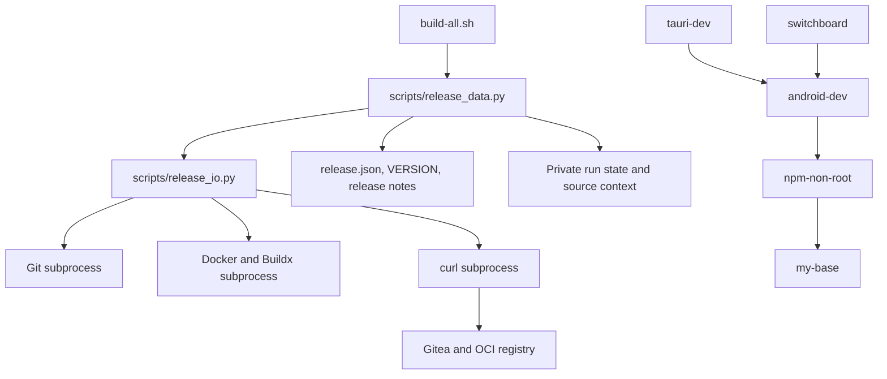

# Brooks-Lint Health Dashboard

- [Dashboard](#dashboard)
- [Module Dependency Graph](#module-dependency-graph)
- [Top Findings](#top-findings)
  - [Warning](#warning)
  - [Suggestion](#suggestion)
- [Verification and Test Suite Map](#verification-and-test-suite-map)
- [Accepted Tradeoffs and Limits](#accepted-tradeoffs-and-limits)
- [Recommendation](#recommendation)

## Dashboard

**Mode:** Health Dashboard

**Scope:** All 16 files changed on `1-update-build-publish` relative to local base branch `main`: `0260a1949639de95fc2ec5694becdb1eba837575...aec33f1`. The branch contains one implementation commit, with 1,799 additions and 180 deletions. Reviewed the shell entry point, Python helpers/configuration, four Dockerfile dependency changes, tests/fakes, version, ignore rules, README, release documentation, and implementation record. Untracked `command.md` and root `docker-compose.yml` are excluded. No project `.brooks-lint.yaml` exists; balanced defaults apply.

**Composite Score:** 97/100

**Trend:** Previous Health Dashboard score 95, current score 97 (+2). The previous record assessed a plan, not implementation; these scores do not establish an improvement trend for executable code.

- Code Quality: 99/100. One suggestion: dependency validation imposes an unnecessary Dockerfile text-prefix contract.
- Architecture: 95/100. One warning: credential isolation drops an unrelated build-network configuration.
- Tech Debt: 100/100. No additional distinct finding in the scoped abbreviated scan; no claim that the entire project is debt-free.
- Test Quality: 95/100. One warning: test expectations depend on the repository's initial release version.

Balanced deductions are five points per warning and one per suggestion, assigned once to their owning dimension. Composite calculation: `99 × 0.25 + 95 × 0.30 + 100 × 0.25 + 95 × 0.20 = 97.25`, rounded half-up to 97. Findings are capped at three per dimension and five overall; all three findings are shown. No Critical finding was established.

**Verdict:** The current offline suite passes, but resolve the two warnings before relying on the workflow across proxy-configured environments or subsequent releases. Native operational readiness remains unverified.

## Module Dependency Graph

Solid edges show orchestration/data dependencies; image edges show parent dependencies. Neither graph has a cycle. Concrete command ports are appropriate at this orchestration boundary and are not themselves a dependency-inversion violation.

## Top Findings

### Warning

**W1 — Architecture / R2: Publication discards Docker-configured build proxies.**

Symptom: `scripts/release_data.py:190-211` reconstructs the private Docker configuration using only empty registry auth, context selection, and plugin directories. It does not retain the original `proxies` configuration. `build-all.sh:56-58` then selects that private configuration for publication builds. Build-only retains the caller's configuration, and the base branch's build command also used the caller's configuration. A temporary offline probe with a configured default HTTPS build proxy confirmed that `docker_auth()` removes it.

Source: *The Pragmatic Programmer* — Orthogonality; *Clean Architecture* — Single Responsibility at the infrastructure-adapter boundary.

Consequence: On networks requiring Docker-configured proxy build arguments, build-only can work while publication loses those arguments and fails during package downloads or setup scripts. Per-daemon `noProxy` policy also disappears. Credential isolation changes build-network behavior without an explicit decision or actionable preflight refusal. This is a concrete configuration-preservation gap, not a claim that the current host requires a proxy.

Remedy: Preserve the required default and selected-endpoint proxy settings through a carefully validated private configuration, without restoring registry auth/helper inventories or logging proxy values. Alternatively, explicitly reject unsupported proxy-dependent configurations before staging and document that limitation. Add offline default/per-daemon proxy-preservation tests and include this case in the separately authorized native checklist. Proxy URLs may contain credentials and must remain private. Docker documents automatic proxy build-argument population in [Docker CLI proxy configuration](https://docs.docker.com/engine/cli/proxy/#build-with-a-proxy-configuration).

**W2 — Test Quality / T2: Tests are coupled to the initial project version.**

Symptom: `tests/test_build_all.py:26-29` copies the current repository `VERSION`, settings, and release notes, while tests at `:97-114`, `:199-230`, `:244-249`, and `:293-296` hard-code `v0.1.0` or the initial notes path. `tests/fake_release_ports.py:187` also hard-codes the requested version for its malformed fifth-image scenario. A temporary fixture updated to valid version 0.1.1 passed `--validate`, but the existing build-only success test failed because it still requested `v0.1.0`.

Source: *xUnit Test Patterns* — Test Brittleness; *The Art of Unit Testing* — Test Isolation; *Software Engineering at Google* — sustainable dependency management.

Consequence: A normal version/notes update breaks tests unrelated to changed behavior. Some negative tests also stop targeting the active release alias, weakening their intended failure scenario. Each release requires coordinated edits to the suite and fake protocol data even though release behavior is unchanged.

Remedy: Give test fixtures their own explicit fixed version/configuration/notes, independent of project release metadata, or derive the active tag and notes path once and use them consistently in assertions and fake failure injection. Add a fixture-version variation that proves success and fifth-image refusal scenarios remain valid for another version. Keep explicit mismatched-tag tests separate from successful publication tests.

### Suggestion

**S1 — Code Quality / R2: Parent validation rejects valid, behavior-preserving Dockerfile headers.**

Symptom: `scripts/release_data.py:85-89` requires each child Dockerfile to start with an exact two-line `ARG`/`FROM` prefix. Prepending the valid `# syntax=docker/dockerfile:1` frontend directive to a temporary copy of `npm.Dockerfile` caused `settings()` to refuse with `Dockerfile parent differs from configured graph`, although the parent argument and `FROM` remained unchanged. Leading explanatory comments or blank lines have the same effect.

Source: *Refactoring* — Change Propagation; *A Philosophy of Software Design* — Information Leakage.

Consequence: Adding a frontend pin or harmless documentation breaks validation and both build modes, forcing unrelated edits to the Python validator. The error reports a graph change when the actual dependency is identical. The fixed five-image graph is intentional; requiring a byte-exact file header is unnecessary coupling beyond that decision.

Remedy: Recognize supported leading parser directives, comments, and blank lines before checking the allowed global parent argument and first `FROM`, while continuing to reject actual parent changes or unsupported ambiguity. Alternatively, remove redundant Dockerfile-prefix checking if explicit release build arguments and source review provide the intended invariant. Add focused behavior-preserving header tests without introducing a general Dockerfile framework.

## Verification and Test Suite Map

- `python3 -B -m unittest discover -s tests -v`: passed, 32 tests in 206.971 seconds during this review.
- `bash -n build-all.sh`: passed.
- `bash build-all.sh --validate`: passed.
- Suite map: one test module with nine data/helper-focused tests and 23 shell-subprocess integration tests (13 local-contract and 10 publication tests). Git object operations use temporary real repositories; Docker, curl, and remote Git effects use stateful fake ports. There are zero native Docker integration or live-service E2E tests.
- The integration-heavy distribution is reasonable for a command-coordination workflow with critical side-effect ordering. Four-minute offline execution is not itself evidence of an architectural test problem; fake command interactions are meaningful observable behavior here, not automatically mock abuse.
- Additional review probes used only temporary fixture files: proxy settings were omitted from private config; a valid frontend directive was rejected; valid 0.1.1 metadata passed validation but failed the version-bound success test. Probe command-effect records remained empty. These probes confirmed findings; they were not added as implementation changes.
- No real image builds, registry login/push, Git remote mutation, release creation, credential reads from the user's configuration, or native readiness checks were performed. No implementation files were modified.

## Accepted Tradeoffs and Limits

- The explicit AMD64-only, five-image graph is justified by existing architecture-specific tooling. Rejecting unsupported build-only drivers is preferable to silently switching builders or pushing parents.
- Digest-bound release parents, committed Dockerfile-only snapshots, private credentials, complete final-alias startup checks, phase-specific guards, and completed read-only retries are appropriate safeguards. Existing tests exercise lost responses and predecessor-alias reversion; this review did not establish a new bypass of those guards.
- The current base Dockerfile's `token` secret change predates this branch and remains untouched. Its setup behavior and mutable external downloads are not new branch regressions.
- Non-atomic cross-service writes, ambiguous-startup refusal, and the lack of automatic rollback/retention are explicit design decisions, not omitted implementation features.
- Native routing, plugin execution, TLS behavior, actual parent-filesystem resolution, and real publication remain outside the evidence provided by fake ports. The documented readiness gate appropriately makes those limitations explicit; they are not separately deducted as undisclosed test gaps.

## Recommendation

Address W1 and W2 in a separate implementation step, then rerun the suite and add their regression cases. S1 is a small compatibility improvement worth including when touching validation. Preserve the current refusal and no-rollback policies; do not use review work as authority to publish or repair remote state. Architecture has the broadest operational impact, so prioritize a focused review of Docker configuration preservation before authorized native qualification. This commit records findings and score history only; it applies no fixes.
