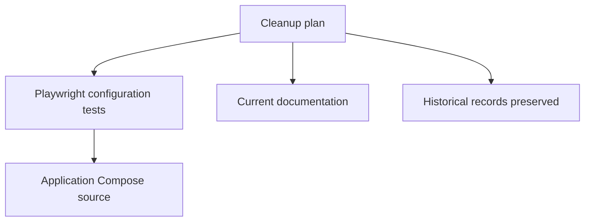

# Brooks-Lint Health Dashboard

- [Brooks-Lint Health Dashboard](#brooks-lint-health-dashboard)
  - [Module Dependency Graph](#module-dependency-graph)
  - [Top Findings](#top-findings)
  - [Test Suite Map](#test-suite-map)
  - [Recommendation](#recommendation)

**Mode:** Health Dashboard
**Scope:** Plan readiness for `tasks/10-remove-opencode-port/2-plan.md` at `c65ca6b`; not implementation health.
**Composite Score:** 100/100
**Scores:** Code Quality 100/100; Architecture 100/100; Tech Debt 100/100; Test Quality 100/100. Balanced scoring; weights 25%, 30%, 25%, and 20%.

The plan matches the requested removal and preserves unrelated behavior and historical records.

## Module Dependency Graph

This graph describes planned changes, not a runtime architecture change.

## Top Findings

No actionable findings. The plan explicitly accepts that removing the check removes the port-specific guard, without creating a replacement policy. It retains the unrelated Playwright privacy and network assertions.

## Test Suite Map

The affected suite currently has six Python offline Playwright configuration tests, including one dedicated to the helper being removed. The plan retains the remaining tests and calls for focused and full Python runs, release validation, and optional Compose configuration checks. These are planned checks, not results from this review.

## Recommendation

Proceed with the plan. Record actual verification results and any unavailable prerequisites during implementation; no broader architecture or test review is necessary for this scoped cleanup.
