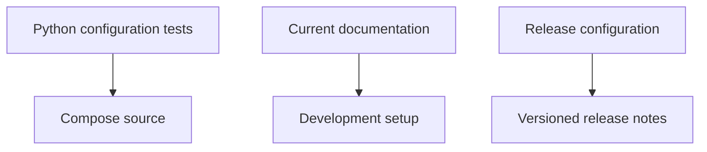

# Brooks-Lint Health Dashboard

- [Brooks-Lint Health Dashboard](#brooks-lint-health-dashboard)
  - [Module Dependency Graph](#module-dependency-graph)
  - [Top Findings](#top-findings)
  - [Test Suite Map and Verification](#test-suite-map-and-verification)
  - [Recommendation](#recommendation)

**Mode:** Health Dashboard
**Scope:** `10-remove-opencode-port` at `b0ee1e6` against parent branch `9-fix-review-warning` at `abe4ae9`; eight changed files.
**Composite Score:** 100/100
**Scores:** Code Quality 100/100; Architecture 100/100; Tech Debt 100/100; Test Quality 100/100. Balanced scoring; weights 25%, 30%, 25%, and 20%. Scores apply only to reviewed branch changes.

The changes remove the requested port-specific checks without changing runtime configuration or unrelated Playwright coverage.

## Module Dependency Graph

## Top Findings

No actionable findings. Removing the check intentionally leaves future application port choices unrestricted, as requested; Playwright server privacy and network assertions remain.

## Test Suite Map and Verification

The affected suite has five Python offline Playwright configuration tests. The Node behavioral tests and Docker smoke runner were not changed.

- Focused Python suite: five tests passed during this review.
- `git diff --check 9-fix-review-warning...HEAD` passed.
- The implementation record reports both Compose configurations and release validation passed. Full Python discovery was still pending when that record was written; no completed result is claimed here.
- No image builds or runtime configuration changes were required for this cleanup.

## Recommendation

Proceed once the full Python suite result is available and recorded. No broader architecture or test review is necessary for this scoped change.
