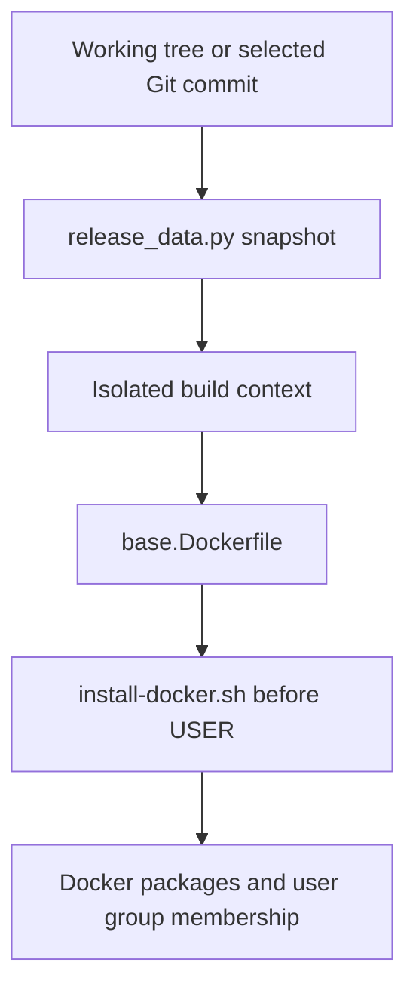

# Brooks-Lint Health Dashboard

- [Brooks-Lint Health Dashboard](#brooks-lint-health-dashboard)
  - [Dimension Scores](#dimension-scores)
  - [Module Dependency Graph](#module-dependency-graph)
  - [Test Suite Map](#test-suite-map)
  - [Top Findings](#top-findings)
  - [Recommendation](#recommendation)

**Mode:** Health Dashboard

**Scope:** Plan readiness: tasks/11-use-local-docker-installer/2-plan.md at ae08bc6; not implementation health. Checked against 1-goal.md, Dockerfile/base.Dockerfile, scripts/install-docker.sh, scripts/release_data.py, and related context tests.

**Composite Score:** 100/100

**Trend:** Stable at 100 versus the latest Health Dashboard record; scopes differ, so this is not an implementation trend.

**Verdict:** Approved for implementation. No blocking gaps found. No implementation code or plan content changed.

## Dimension Scores

- Code Quality: Not scored; no implementation diff exists.
- Architecture: 100/100. The plan extends the existing snapshot boundary instead of introducing another build path.
- Tech Debt: 100/100. Changes remain focused on installation, layer cleanup, and required build inputs.
- Test Quality: 100/100. Planned checks cover installer failure, context isolation, source selection, and Dockerfile integration.

Default balanced scoring applies; no .brooks-lint.yaml exists. With Code Quality skipped, weights are Architecture 0.30/0.75, Tech Debt 0.25/0.75, and Test Quality 0.20/0.75. No findings produce a composite score of 100.

## Module Dependency Graph

Planned artifact flow; arrows mean produces or supplies a build input, not Python imports.

The current snapshot excludes scripts (scripts/release_data.py:723-731). Plan steps 3 and 4 address that integration requirement and the exact context allowlists in tests/fake_release_ports.py:154 and tests/test_build_all.py:536. Local versus selected-commit sourcing preserves the existing release boundary. Coordinated edits here belong to one build feature, not unrelated change propagation.

## Test Suite Map

Planned coverage groups, not counts of implemented test methods:

- Static and syntax: One group covering Bash syntax, strict mode, apt-get, COPY/RUN placement, remote installer removal, and cleanup.
- Isolated execution: One group checking that package-command failure stops the real installer through safe command stubs.
- Snapshot integration: Two source modes, local working-tree bytes and published selected-commit bytes, including differing working-tree content.
- Build integration: Updated fake build-context allowlists and the existing Python regression suite.
- Live validation: One conditional base-image build; unavailable prerequisites must be reported. No image publication is required.

The failure-path check provides behavior coverage beyond checking that strict-mode text exists. Context assertions protect a deliberate credential-isolation contract, not incidental implementation layout. Tests and live builds were not run during this plan-only review.

## Top Findings

None. The plan covers every requested outcome and the required isolated-context changes. Separate cleanup in both package-installing RUN instructions prevents apt lists remaining in an earlier image layer. The unchanged user setup download is explicitly outside this task.

## Recommendation

Proceed with this plan when implementation is requested. Preserve the explicit source-selection tests and safe failure-path execution. Treat the score as plan readiness only; implementation correctness still requires the planned validation.
