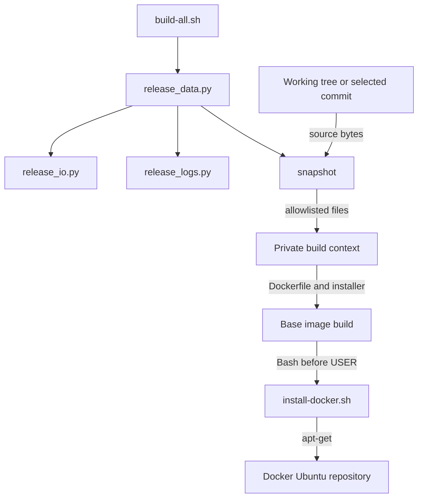

# Brooks-Lint Health Dashboard

- [Brooks-Lint Health Dashboard](#brooks-lint-health-dashboard)
  - [Dimension Scores](#dimension-scores)
  - [Module Dependency Graph](#module-dependency-graph)
  - [Test Suite Map](#test-suite-map)
  - [Top Findings](#top-findings)
    - [Warning](#warning)
  - [Verification And Limits](#verification-and-limits)
  - [Recommendation](#recommendation)

**Mode:** Health Dashboard

**Scope:** All 12 changed files on 11-use-local-docker-installer, main (89b3093)...HEAD (6eb84af). Includes Dockerfile, installer, snapshot handling, tests, documentation, version metadata, and implementation results. Working tree was clean before review.

**Composite Score:** 99/100

**Trend:** 100 → 99 versus the latest Health Dashboard record. That record assessed the plan, so this is not an implementation regression trend.

**Verdict:** One validation warning. Installation integration and focused tests look sound, but full-suite and live-build acceptance remain incomplete.

## Dimension Scores

- Code Quality: 100/100. The installation sequence is linear, and coordinated changes belong to one build feature.
- Architecture: 100/100. Snapshotting retains the existing working-tree versus selected-commit boundary; no new import cycle or reversed dependency was introduced.
- Tech Debt: 95/100. Required-source knowledge differs between validation and snapshot preparation; one Warning, counted only here.
- Test Quality: 100/100. Changed tests have clear scenarios, isolated fixtures, and observable outcome assertions. Exact context contents enforce the intentional input and credential boundary.

No .brooks-lint.yaml exists; balanced deductions apply. Composite: round-half-up(100 × 0.25 + 100 × 0.30 + 95 × 0.25 + 100 × 0.20) = 99. Scores cover this branch's changes, not whole-project readiness.

## Module Dependency Graph

Solid arrows show calls or imports; labeled arrows show build-input flow.

The new installer is copied explicitly rather than broadening the context to all scripts. Publication uses blob() and local mode uses regular() plus read(), preserving existing source-file checks. Cleanup occurs in both package-installing RUN instructions; removing lists only in the final layer would not have cleaned the earlier layer.

## Test Suite Map

Scope: five directly added or modified test methods, not the whole suite.

- Static/unit contracts: 2 new tests for strict mode, apt-get, local COPY/RUN placement, and cleanup.
- Isolated subprocess integration: 1 new test, with first-command failure, final-package failure, and success subcases. All external installer commands use safe PATH stubs.
- Snapshot integration: 2 tests, one new and one updated, covering local versus selected-commit installer bytes, captured certificates, and context contents.
- Native image/E2E tests: 0 automated tests in this change. The updated fake Docker boundary also checks context allowlists during existing workflow tests.

The stubs protect this container while exercising the actual Bash script and its exit status. They do not prove that real Docker packages install successfully. No unrelated refactoring is needed merely because this shell seam uses several fake commands.

## Top Findings

### Warning

**Required-input validation lags behind snapshot preparation — change propagation (R2)**

Symptom: scripts/release_data.py:730-733 adds scripts/install-docker.sh as a mandatory snapshot input, but settings() at lines 74-105 does not validate that source. In a temporary fixture, deleting only the installer leaves `bash build-all.sh --validate` exiting 0 with `Configuration valid; no credentials or external operations used`; local snapshot creation then refuses with `Required source file is missing`. Existing Dockerfile inputs are checked during settings validation. The documentation still promises source-path validation.

Source: A Philosophy of Software Design — Information Hiding and Leakage; Code Complete — defensive programming and explicit error handling. Required build-input knowledge is split between validation and execution and has drifted for this new dependency.

Consequence: Offline validation can approve an unusable checkout. Users discover the missing dependency only after later build preflight operations, defeating the documented early source-check contract. The actual snapshot still refuses safely; no credential leak or image publication was observed.

Remedy: Validate the installer with the existing regular() source-path check during settings validation. Add temporary-fixture regressions for missing and symlinked installer paths, asserting that `--validate` refuses without Docker, credentials, or network operations. Keep published snapshots sourced from the selected commit.

## Verification And Limits

- Re-ran Bash installer syntax and `bash build-all.sh --validate`: passed for the intact checkout.
- Re-ran all three installer tests and both affected snapshot tests: 5 passed in 0.139 seconds.
- Reproduced the validation warning using a temporary Git fixture; no project source was removed or modified.
- The implementation-stage full run completed 129 tests: 128 passed, one failed after 546.973 seconds. This review did not repeat that nine-minute suite.
- Independently reproduced the same excluded-image test failure against base commit 89b3093 in a temporary checkout. tests/test_package_release.py:236 requires the already-deleted Dockerfile/switchboard.Dockerfile. This is a confirmed baseline failure, not a branch regression or scored finding.
- The implementation-stage local build stopped in certificate preflight because configured CA inputs were unreadable. No live image build succeeded; package installation, image behavior, and publication remain unverified. This review ran no native build or publication.
- Version 0.1.19, its notes path, and release-note heading agree. README and release documentation describe the new local installer.

## Recommendation

Address the validation warning before relying on `--validate` as complete source-input acceptance. Separately resolve the baseline Switchboard test expectation and provide readable CA inputs before claiming full-suite or live-build success. If broader test maintenance is requested, use brooks-test; no fixes were implemented in this review.
