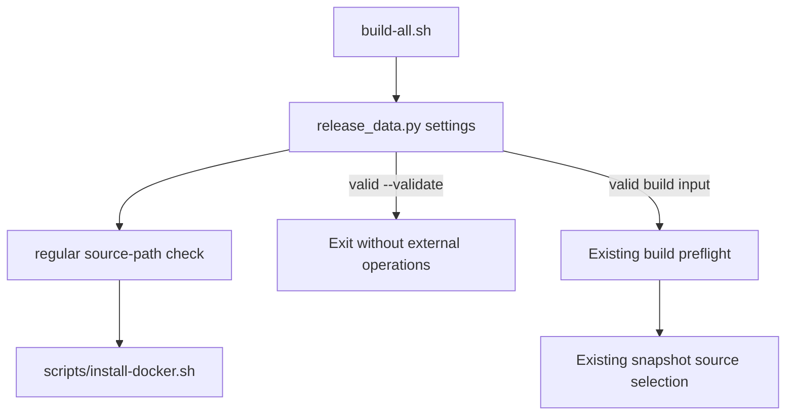

# Brooks-Lint Health Dashboard

- [Brooks-Lint Health Dashboard](#brooks-lint-health-dashboard)
  - [Dimension Scores](#dimension-scores)
  - [Module Dependency Graph](#module-dependency-graph)
  - [Test Suite Map](#test-suite-map)
  - [Top Findings](#top-findings)
  - [Recommendation](#recommendation)

**Mode:** Health Dashboard

**Scope:** Plan readiness: tasks/12-fix-installer-validation/2-plan.md at 1e914cf, checked against its goal, the previous review warning, settings(), regular(), build-all.sh, and existing fixture and snapshot tests. Not an implementation or whole-project assessment.

**Composite Score:** 100/100

**Trend:** 99 → 100 versus the latest Health Dashboard record. Scopes differ: that record reviewed task 11 implementation, while this score measures task 12 plan readiness. The warning is not yet fixed.

**Verdict:** Approved for implementation. No findings in the plan.

## Dimension Scores

- Code Quality: Not scored; this task has no implementation diff yet.
- Architecture: 100/100. The plan reuses the existing settings entry point and source-path validator without changing build sequencing or snapshot ownership.
- Tech Debt: 100/100. A focused early check fixes the reported gap without a speculative framework or unrelated cleanup.
- Test Quality: 100/100. Planned fixtures exercise invalid source paths across all modes and assert refusal before external operations.

No .brooks-lint.yaml exists; balanced scoring applies. With Code Quality omitted for this plan-only scope, weights are Architecture 0.30/0.75, Tech Debt 0.25/0.75, and Test Quality 0.20/0.75. All scored dimensions have zero findings, yielding 100.

## Module Dependency Graph

Planned control flow; the new check stays inside the existing validation boundary.

build-all.sh:35 invokes settings before tool checks, locking, temporary directories, certificates, or credentials. regular() at scripts/release_data.py:48-57 already rejects missing files, symlinks, and escaped paths. Reusing that check at the settings boundary directly addresses the warning while leaving snapshot bytes and release identity rules intact.

## Test Suite Map

Planned scenarios, not implemented test-method counts:

- New CLI integration matrix: 6 refusal scenarios, combining missing or symlinked installer inputs with validation, local build, and publication modes.
- Existing positive validation: 1 scenario proving intact sources validate without token or certificate inputs.
- Existing snapshot integration: 1 test covering 2 source modes, preserving working-tree bytes locally and selected-commit bytes for publication.
- Native image/E2E checks: 0 required for this local path-validation change.
- Full regression suite: planned with a suitable timeout and explicit baseline-failure reporting.

An in-repository regular symlink target distinguishes symlink rejection from path-escape rejection. Missing fixture credentials, exact source refusals, empty fake call/effect records, and unchanged file inventories make the early-refusal claim observable. These are behavioral safety assertions, not incidental internal call-order constraints.

## Top Findings

None. The plan covers the requested warning, preserves publication sourcing, and includes both negative and positive validation coverage. It correctly excludes installer permission/content policies, image changes, real credentials, and the unrelated baseline Switchboard failure.

## Recommendation

Implement the plan when requested. Record actual verification results without treating the baseline suite failure as a new regression or claiming full-suite success. This review changed neither implementation code nor 2-plan.md and ran no tests, native builds, or publication.
