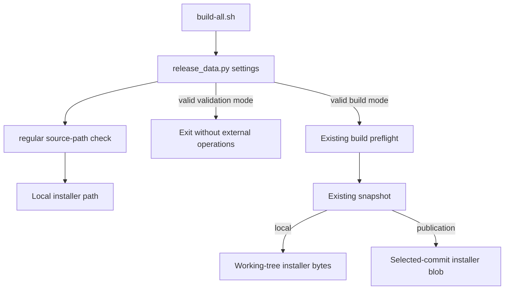

# Brooks-Lint Health Dashboard

- [Brooks-Lint Health Dashboard](#brooks-lint-health-dashboard)
  - [Dimension Scores](#dimension-scores)
  - [Module Dependency Graph](#module-dependency-graph)
  - [Test Suite Map](#test-suite-map)
  - [Top Findings](#top-findings)
  - [Verification And Limits](#verification-and-limits)
  - [Recommendation](#recommendation)

**Mode:** Health Dashboard

**Scope:** All 8 changed files on 12-fix-installer-validation relative to its actual base branch, 11-use-local-docker-installer (60829be)...HEAD (ef24600). Includes the validator change, tests, README, release documentation, version metadata, and implementation record. Parent-branch changes are not counted again. Working tree was clean before review.

**Composite Score:** 100/100

**Trend:** Stable at 100 versus the latest Health Dashboard record, which assessed this task's plan. This is not a whole-project implementation trend.

**Verdict:** No findings introduced by this branch. The previous installer-validation warning is resolved; the unrelated baseline test failure remains.

## Dimension Scores

- Code Quality: 100/100. One early source check reuses existing behavior without adding complex control flow.
- Architecture: 100/100. Validation stays at the existing settings boundary, before build operations; source selection remains unchanged.
- Tech Debt: 100/100. No parallel validator, new framework, or unrelated policy was introduced.
- Test Quality: 100/100. Named missing-file and symlink scenarios assert observable refusal and absence of external effects across all modes.

No .brooks-lint.yaml exists; balanced scoring applies. Zero findings in all dimensions gives 100 × 0.25 + 100 × 0.30 + 100 × 0.25 + 100 × 0.20 = 100. This scoped score does not certify full-suite success or live builds.

## Module Dependency Graph

Control flow through the affected boundary; no new module imports were added.

scripts/release_data.py:91 now checks the installer through regular(). build-all.sh:35 runs settings before Docker checks, locking, temporary directories, certificates, or credentials. The unchanged regular() rejects symlinks and missing or escaped paths. The unchanged snapshot() still selects working-tree bytes locally and committed bytes for publication.

## Test Suite Map

Scope: newly added tests and directly relevant existing checks, not the whole suite.

- New isolated CLI integration tests: 2 methods, covering 6 combinations of invalid source type and invocation mode.
- Existing positive offline validation: 1 method, with token and certificates absent.
- Existing snapshot integration: 1 method, covering local and published installer sources with differing working-tree content.
- New standalone unit tests: 0; the fix reuses the existing path validator and tests its public CLI behavior.
- Native image/E2E tests: 0 added or required for this local validation change.

The symlink targets an existing regular file inside the fixture, so the test exercises symlink refusal rather than a missing target or path escape. Source-specific errors, empty fake command/effect logs, no lock or run directory, and unchanged inventories support the same early-refusal contract. The helper shares relevant setup without coupling assertions to internal Python calls.

## Top Findings

None. The required installer now participates in offline settings validation, directly resolving the previous warning. Version 0.1.20, the configured notes path, release-note heading, and updated documentation agree. Installation behavior and historical releases are unchanged.

## Verification And Limits

- Re-ran both new refusal tests, positive offline validation, and installer source-selection regression: 4 tests passed in 0.511 seconds.
- `bash build-all.sh --validate`: passed for the intact checkout without credentials or external operations.
- `git diff --check`: passed.
- Implementation-stage full suite: 131 tests in 548.465 seconds, with 130 passed and one confirmed baseline failure at tests/test_package_release.py:236. The test expects the already-deleted Dockerfile/switchboard.Dockerfile; neither that test nor the file changed on this branch. This review did not rerun the nine-minute suite.
- No native build, publication, real credential access, or certificate permission changes occurred during this review. Live image behavior remains outside this validation-only assessment.

## Recommendation

Accept this scoped fix. Track the stale Switchboard expectation separately before claiming a green full suite. No further changes are required by this review, and no implementation fixes were applied.
