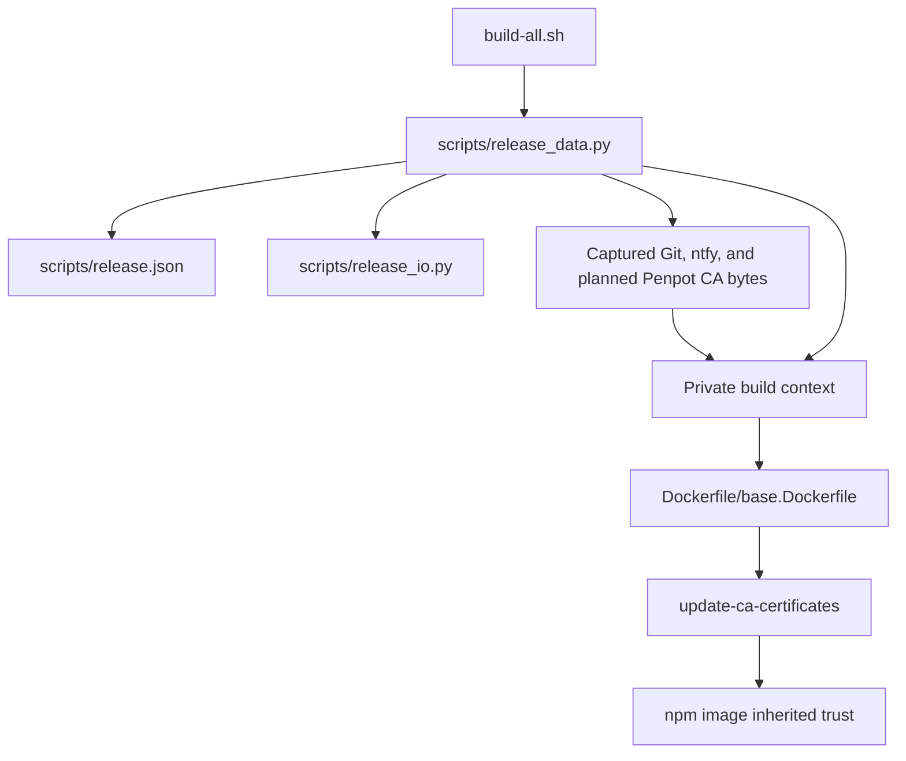

- [Dashboard](#dashboard)
- [Module Dependency Graph](#module-dependency-graph)
- [Test suite map](#test-suite-map)
- [Findings](#findings)
- [Recommendation](#recommendation)

## Dashboard

**Mode:** Health Dashboard

**Scope:** Plan readiness: `tasks/13-add-penpot-ca-certificate/2-plan.md` at `56b6d73`, checked against the goal and existing certificate pipeline. This is not an implementation health assessment.

**Composite Score:** 100/100

**Trend:** Stable at 100 versus the latest dashboard record; scopes differ, so this is not evidence of unchanged implementation health.

No `.brooks-lint.yaml` exists; balanced defaults apply. The code-quality dimension evaluates the proposed changes, not an implementation diff.

- Code quality: 100/100. The plan identifies configuration, strict field validation, context preparation, Dockerfile ordering, and documentation changes without unrelated work.
- Architecture: 100/100. Adding one `CERTIFICATES` entry reuses existing capture, fingerprint, snapshot, and guard behavior; no new dependency layer is needed.
- Tech debt: 100/100. No parallel certificate pipeline or speculative abstraction is proposed. Explicit Dockerfile copies and configuration fields preserve the current design.
- Test quality: 100/100. Planned tests cover input boundaries, captured-byte isolation, fingerprint identity, guards, both build modes, and certificate-free validation.

Weights: code quality 0.25, architecture 0.30, tech debt 0.25, test quality 0.20. No deductions.

## Module Dependency Graph

The graph describes the scoped build-input flow, including the planned third certificate, rather than a whole-project import audit. Existing `init()` captures inputs before builder and credential operations; `snapshot()` iterates `CERTIFICATES`; `unchanged()` recomputes the aggregate fingerprint.

## Test suite map

The relevant existing file, `tests/test_build_all.py`, contains 50 test methods: 18 local contract tests, 13 publication tests, and 19 data-boundary tests. These mix direct boundary tests and CLI integration tests using temporary repositories and fake external commands; the counts are not a strict unit/integration split. No real-image end-to-end certificate test is present in this scoped file.

The plan extends these seams rather than requiring live services for automated tests. Exact context contents and certificate-copy ordering are intentional build contracts, not incidental implementation assertions. Mocking permission failures is appropriate for reliable unreadable-input checks. Real-image trust verification is optional and must be reported separately from fixture success.

## Findings

No critical, warning, or suggestion findings. The plan matches `1-goal.md` and accounts for all known certificate integration points. Current-container HTTPS success is explicitly not treated as proof of rebuilt-image trust.

## Recommendation

Approve the plan for implementation. Preserve the shared certificate pipeline and extend existing tests as written. Record any skipped real build or image-level verification; do not publish, download certificates, alter host trust, or bypass TLS. No implementation code or plan content was changed during this review, and no tests or builds were run.
