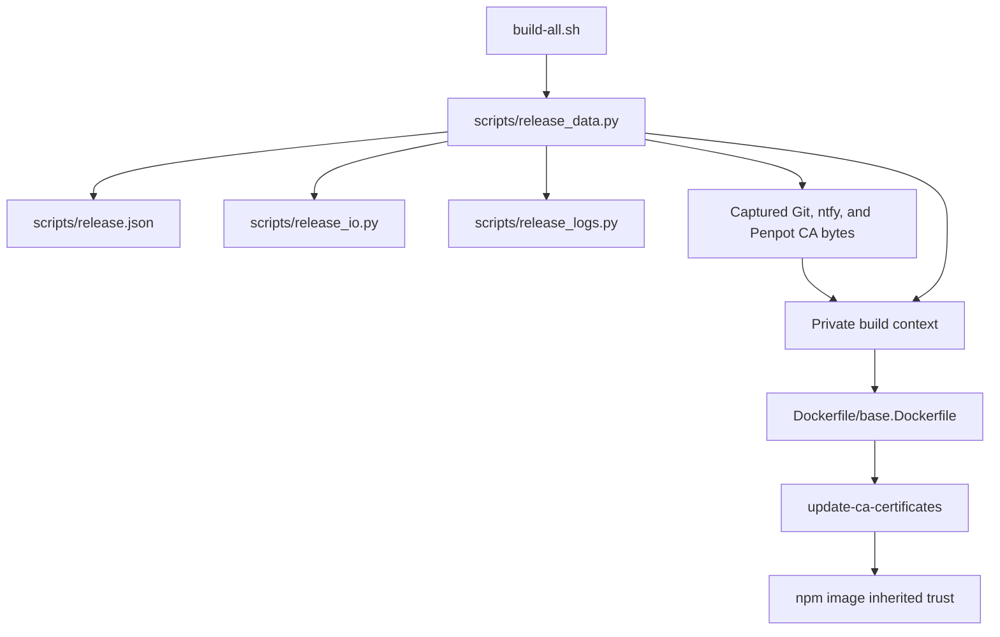

- [Dashboard](#dashboard)
- [Module Dependency Graph](#module-dependency-graph)
- [Test suite map](#test-suite-map)
- [Findings](#findings)
- [Verification and limits](#verification-and-limits)
- [Recommendation](#recommendation)

## Dashboard

**Mode:** Health Dashboard

**Scope:** All 10 changed files on `13-add-penpot-ca-certificate` at `e531669`, relative to base `main` at merge-base `7530200`. Includes implementation, tests, documentation, release metadata, and implementation results.

**Composite Score:** 100/100

**Trend:** Stable at 100 versus the previous dashboard; that record assessed plan readiness, so the scores do not establish an implementation trend.

No `.brooks-lint.yaml` exists; balanced defaults apply.

- Code quality: 100/100. The Penpot registry entry, strict configuration field, default path, override name, and Dockerfile destination agree. No unrelated behavior changes were introduced.
- Architecture: 100/100. Existing capture, snapshot, fingerprint, and guard functions handle the third certificate without new dependencies or duplicated algorithms.
- Tech debt: 100/100. The change preserves the current small configuration interface and explicit Dockerfile copies. Coordinated edits remain within one certificate build-input concern.
- Test quality: 100/100. Isolated fixtures and behavior-focused assertions cover all three certificates, both snapshot modes, input failures, identity changes, and offline validation.

Weights: code quality 0.25, architecture 0.30, tech debt 0.25, test quality 0.20. No deductions. This score describes scoped review findings, not release readiness or verified image trust.

## Module Dependency Graph

Arrows describe the relevant dependency and build-input flow, not a whole-project import audit. `CERTIFICATES` drives capture and snapshot inclusion; fingerprints bind filenames and contents; publication guards reread original inputs. `build-all.sh` initializes certificates before builder operations and credential loading. Validation exits before certificate initialization. The npm Dockerfile inherits the base image.

## Test suite map

The changed `tests/test_build_all.py` contains 51 test methods: 18 local contract tests, 13 publication tests, and 20 data-boundary tests. It combines direct boundary tests and CLI integration tests using temporary repositories and fake external commands; these are not strict unit/integration counts. The whole Python suite contains 132 tests. Real-image certificate end-to-end verification was not completed.

The added Penpot fixture is required build input rather than an unrelated shared fixture. The fake's exact context inventory protects the isolation contract. Permission mocks simulate a nondeterministic filesystem failure; assertions still check sanitized refusal and absence of initialization side effects. Name-swap, content-change, captured-byte, and copy-order assertions protect distinct risks rather than duplicating one scenario.

## Findings

No critical, warning, or suggestion findings introduced by this branch. The implementation follows the approved plan, including the version bump and documentation updates. No certificates, credentials, host trust modifications, TLS bypasses, or publication writes appear in the changes.

## Verification and limits

- Review rerun: `python3 -B -m unittest discover -s tests -p test_build_all.py -k DataBoundaryTests -k invalid_certificates -k host_only_docker -k validation_has_no_external`: all 23 selected tests passed in 6.762 seconds.
- Review rerun: `bash build-all.sh --validate` and `git diff --check main...HEAD`: passed.
- Implementation-stage full suite, observed earlier in this session: 131 passed and one failed out of 132 tests. The failure expects missing manual-image Dockerfiles and was reproduced against an isolated `main` checkout. It is not a regression introduced by this branch; the full suite was not repeated during this review.
- Implementation-stage real build stopped at Git certificate preflight. Git and ntfy CA files were unreadable to the current user; Penpot's file was readable. No image-level trust claim can be made from fixture success or current-container HTTPS access.
- No fixes, real builds, publication operations, or host changes were performed during this review.

## Recommendation

Approve the scoped implementation. Before release, provide readable valid Git and ntfy CA inputs and complete a local build with image-level certificate and HTTPS verification. Track the pre-existing missing-manual-Dockerfile test failure separately; do not describe the full suite as green.
