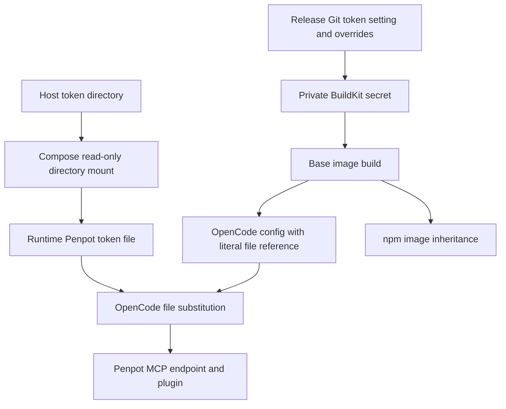

- [Dashboard](#dashboard)
- [Module Dependency Graph](#module-dependency-graph)
- [Test coverage](#test-coverage)
- [Findings](#findings)
- [Recommendation](#recommendation)

## Dashboard

**Mode:** Health Dashboard

**Scope:** Plan readiness: `tasks/14-configure-penpot-mcp/2-plan.md` at `564b0c5`, checked against current Dockerfile, Compose, release credentials, tests, and the user's shared-token-directory requirement. Not implementation health.

**Composite Score:** 100/100

**Trend:** Stable at 100 versus the previous dashboard; scopes differ, so this is not an implementation trend.

No `.brooks-lint.yaml` exists; balanced defaults apply. Code quality evaluates the proposed change rather than an implementation diff.

- Code quality: 100/100. Paths, ownership, migration boundaries, and preservation requirements are explicit.
- Architecture: 100/100. Runtime mounting stays separate from BuildKit secrets; npm inherits the base configuration.
- Tech debt: 100/100. One token-directory convention replaces separate mounts without introducing another credential pipeline.
- Test quality: 100/100. Planned tests cover configuration preservation, runtime substitution failures, Git compatibility, mount contracts, and secret isolation.

Weights: code quality 0.25, architecture 0.30, tech debt 0.25, test quality 0.20. No deductions.

## Module Dependency Graph

This is the proposed credential/configuration flow, not a whole-project import audit. The runtime directory mount does not provide a Docker build secret automatically.

## Test coverage

Existing relevant coverage combines direct credential-boundary tests and fake-port CLI integration tests in `tests/test_build_all.py` (51 methods), plus isolated installer/Dockerfile checks. The plan adds offline MCP configuration and substitution checks; it does not claim existing real-image MCP end-to-end coverage. Synthetic credentials, isolated HOME/XDG directories, and preservation assertions address the main change risks without relying on live Penpot.

## Findings

No critical, warning, or suggestion findings. The shortened plan retains the required shared mount, both Git path changes, legacy overrides, literal Penpot file reference, JSONC safeguards, and migration documentation. The broader Git migration is explicitly authorized by the user's follow-up request.

## Recommendation

Approve for implementation. Verify the installed OpenCode version's file-reference persistence and runtime loading before choosing the merge mechanism. Keep real-token migration user-run, report missing-file behavior accurately, and separate successful configuration from authenticated plugin access. Known baseline test failures and unavailable real-build prerequisites remain verification limits, not evidence of completed image validation. No tests, builds, implementation edits, or plan edits were performed during this review.
