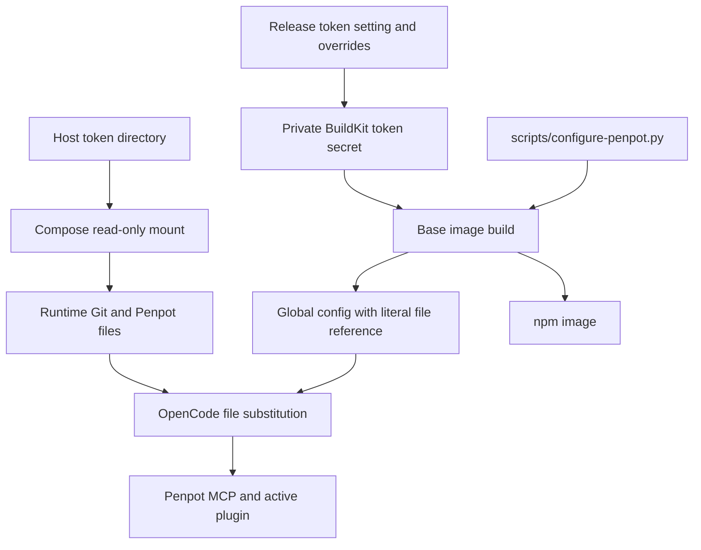

- [Dashboard](#dashboard)
- [Module Dependency Graph](#module-dependency-graph)
- [Test suite map](#test-suite-map)
- [Findings](#findings)
  - [Warning — JSONC cleanup rewrites malformed input](#warning--jsonc-cleanup-rewrites-malformed-input)
- [Verification and limits](#verification-and-limits)
- [Recommendation](#recommendation)

## Dashboard

**Mode:** Health Dashboard

**Scope:** All 14 changed files on `14-configure-penpot-mcp` at `b762028`, relative to base `main` at merge-base `949fad8`. Includes code, tests, Compose, docs, release metadata, and implementation results.

**Composite Score:** 99/100

**Trend:** 100 → 99 compared with the last dashboard, which reviewed this task's plan rather than its implementation.

No `.brooks-lint.yaml` exists; balanced defaults apply.

- Code quality: 95/100. One warning: JSONC cleanup accepts malformed syntax and replaces the original file.
- Architecture: 100/100. Runtime directory mounting, config generation, and BuildKit secrets remain separate; npm inherits the base configuration.
- Tech debt: 100/100. Shared paths and helper snapshot integration are consistent. No additional independent debt findings.
- Test quality: 100/100. Tests isolate config and credentials and protect the intended contracts. Missing malformed-JSONC coverage is included in the code-quality warning rather than counted twice.

Weights: 0.25, 0.30, 0.25, 0.20 respectively. Weighted score: 98.75, rounded to 99. No critical findings.

## Module Dependency Graph

This is the scoped build/configuration flow, not a whole-project import graph. Both local and publication snapshots include the helper; required-source checks reject missing and symlinked helper paths before external operations.

## Test suite map

`tests/test_build_all.py` contains 55 methods: 20 local contracts, 13 publication scenarios, and 22 data-boundary checks. `tests/test_penpot_mcp.py` adds seven config/runtime-loading checks and two image/Compose contracts. These combine direct boundary tests, static image checks, fake-port CLI integration, and isolated real OpenCode config loading; they are not a strict unit/integration count. The full Python suite has 145 tests. No successful real-image MCP end-to-end verification is available.

## Findings

### Warning — JSONC cleanup rewrites malformed input

- **Symptom:** `scripts/configure-penpot.py:51-55` runs the same comment/trailing-comma cleanup twice. Each pass can remove one trailing comma. Synthetic inputs `{"username":"example",,}` and `{"instructions":["example",,]}` were both accepted and overwritten with normalized output. `tests/test_penpot_mcp.py:71-81` checks malformed `.json`, but not malformed `.jsonc`.
- **Source:** *Code Complete* — Defensive Programming: distinguish tolerated syntax from invalid input before mutation. *The Art of Unit Testing* — Completeness of edge-path tests.
- **Consequence:** The helper silently repairs invalid configuration instead of refusing it unchanged, contradicting its documented preservation/failure contract. A broken existing config can pass the build and lose its original diagnostic evidence.
- **Remedy:** Separate comment removal from a single trailing-comma removal pass, retaining string protection, or use a proper JSONC parser. Add object/array double-comma rejection cases and verify byte-for-byte preservation on failure. Retain tests for valid trailing commas separated from closing brackets by comments. Do not apply the same syntax-normalization pass repeatedly.

## Verification and limits

- Review reruns: all nine Penpot config/image tests and five selected Git/configurator tests passed. Offline build validation, Compose validation, and branch whitespace checks passed.
- Review reproduction: both malformed JSONC examples above were accepted and rewritten in isolated temporary directories. No implementation or test files were changed.
- Previously observed implementation run: 144/145 tests passed; the sole missing-manual-Dockerfile failure was reproduced against `main`. The full suite was not repeated during review.
- Real image building remains blocked by Git CA preflight. Config creation and synthetic substitution do not establish authenticated MCP connectivity; implementation-stage isolated MCP listing returned no registered servers despite config discovery. These limitations remain explicit in docs and results.

## Recommendation

Fix the JSONC refusal warning before merging, then rerun the focused config tests and existing validation. Preserve the shared mount and credential safeguards. Complete real-image and authenticated plugin verification when valid readable prerequisites are available; do not treat the baseline test failure or blocked build as a successful release check. No fixes, publication operations, or host-token changes were performed during this review.
