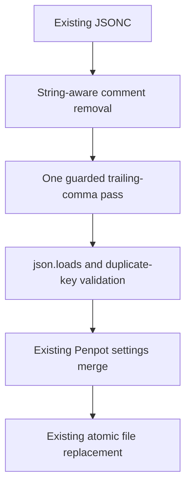

- [Dashboard](#dashboard)
- [Module Dependency Graph](#module-dependency-graph)
- [Test coverage](#test-coverage)
- [Findings](#findings)
- [Recommendation](#recommendation)

## Dashboard

**Mode:** Health Dashboard

**Scope:** Plan readiness: `tasks/15-fix-jsonc-review-warning/2-plan.md` at `c1ff933`, checked against the current helper, tests, goal, and task 14's JSONC warning. Not implementation health.

**Composite Score:** 100/100

**Trend:** 99 → 100 versus the previous implementation review. Different scopes: the existing warning is not fixed yet.

No `.brooks-lint.yaml` exists; balanced defaults apply. Code quality evaluates the proposed fix rather than an implementation diff.

- Code quality: 100/100. Separating comment removal from one guarded trailing-comma pass directly addresses repeated syntax repair.
- Architecture: 100/100. Final parsing, duplicate-key checks, and atomic writes retain their existing boundaries; no new dependencies are planned.
- Tech debt: 100/100. The fix stays within the helper and avoids a general parser framework or unrelated token changes.
- Test quality: 100/100. Planned cases protect invalid-input refusal, original bytes, CLI sanitization, and valid JSONC/string handling.

Weights: code quality 0.25, architecture 0.30, tech debt 0.25, test quality 0.20. No deductions.

## Module Dependency Graph

This is the proposed scoped data flow, not a whole-project dependency audit. Invalid input must stop before directory or file mutation.

## Test coverage

The existing focused suite has nine tests: six helper/CLI checks, one isolated OpenCode runtime-loading check, and two image/Compose contracts. Malformed-input tests currently target `.json`, leaving the reviewed `.jsonc` issue uncovered. The plan adds direct helper and CLI regressions with distinct risks, plus valid JSONC compatibility cases. No real-image or live Penpot test is needed to verify this parsing fix.

## Findings

No critical, warning, or suggestion findings in the plan. It covers both reviewed double-comma examples and nearby comma-only/missing-value cases that an unguarded single-pass replacement could still accept. Byte-preservation and sanitized CLI failure checks close the relevant regression gap without changing credential behavior.

## Recommendation

Approve for implementation. Keep invalid-input tests red before the fix and verify original bytes remain unchanged afterward. Preserve valid commented trailing commas and escaped strings. Report the known baseline suite failure separately; this plan review does not resolve task 14's code warning. No implementation, plan edits, tests, or builds were performed during this review.
