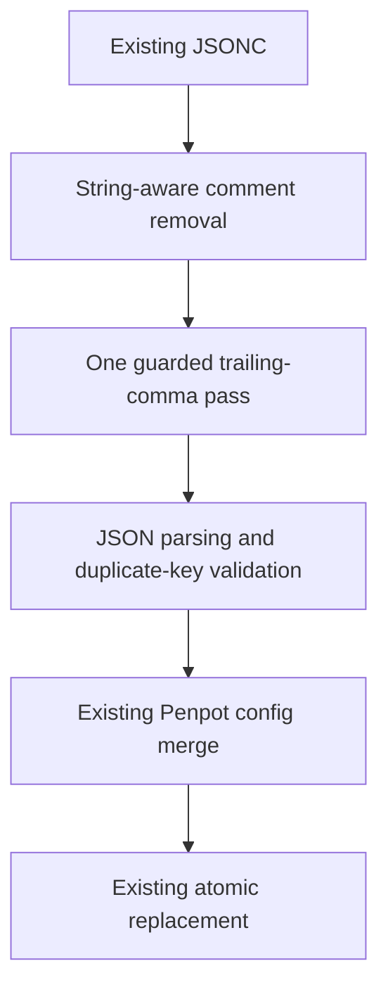

- [Dashboard](#dashboard)
- [Module Dependency Graph](#module-dependency-graph)
- [Test coverage](#test-coverage)
- [Findings](#findings)
- [Verification and limits](#verification-and-limits)
- [Recommendation](#recommendation)

## Dashboard

**Mode:** Health Dashboard

**Scope:** All eight changed files on `15-fix-jsonc-review-warning` at `46f0ae9`, relative to its actual parent branch `14-configure-penpot-mcp` at merge-base `7b362a2`. Includes parsing, tests, docs, release metadata, and implementation results. Inherited task 14 changes were reviewed separately.

**Composite Score:** 100/100

**Trend:** Stable at 100 versus the previous plan review; compared with task 14's implementation review, the identified JSONC warning is now resolved in this descendant branch.

No `.brooks-lint.yaml` exists; balanced defaults apply.

- Code quality: 100/100. Cleanup stages run separately and once, with guarded comma removal and final JSON validation before writes.
- Architecture: 100/100. Parsing remains separate from merging and atomic replacement; credential and image boundaries are unchanged.
- Tech debt: 100/100. The local fix adds no dependencies, alternate parser pipeline, or unrelated configuration changes.
- Test quality: 100/100. Direct and CLI regressions verify refusal, original bytes, directory contents, sanitized errors, and valid JSONC compatibility.

Weights: code quality 0.25, architecture 0.30, tech debt 0.25, test quality 0.20. No deductions.

## Module Dependency Graph

The graph describes the scoped data flow, not a whole-project import audit. Unchanged invalid commas remain for final parsing to reject; parsing still precedes directory creation and temporary writes.

## Test coverage

The focused suite now has 12 tests: nine helper/CLI cases, one isolated OpenCode runtime-loading case, and two image/Compose contracts. The new malformed-input method covers 15 subcases, including both original double-comma examples. Separate valid-input and CLI checks protect distinct risks rather than duplicate the same assertion. CRLF byte comparisons and directory inventories verify refusal side effects; synthetic data and isolated directories avoid real credentials.

## Findings

No critical, warning, or suggestion findings. Task 14's warning is resolved: repeated comma stripping is removed, comma-only and missing-value forms remain invalid, and regressions verify the original file is untouched. Strings, valid commented trailing commas, token handling, and atomic writes remain protected. Version `0.1.23`, release notes, and configured notes path agree.

## Verification and limits

- Review rerun: all 12 tests in `tests/test_penpot_mcp.py` passed in 2.214 seconds, including the reviewed examples and CLI refusal.
- Review reruns: `bash build-all.sh --validate` and `git diff --check 14-configure-penpot-mcp...HEAD` passed.
- Implementation-stage full suite, observed earlier in this session: 147/148 passed. The only failure expects manual-image Dockerfiles absent from the baseline; it is not changed by this fix. The full suite was not repeated during review.
- No live Penpot, real tokens, real image builds, or publication operations were used. Task 14's unverified real-image/authenticated-plugin limits remain; this parsing review does not certify them. No implementation fixes were made during review.

## Recommendation

Approve this fix. The prior JSONC warning is closed in the current branch; retain the historical review as written. Track the unrelated baseline test failure and image/MCP readiness separately rather than claiming a fully green suite or verified deployment.
