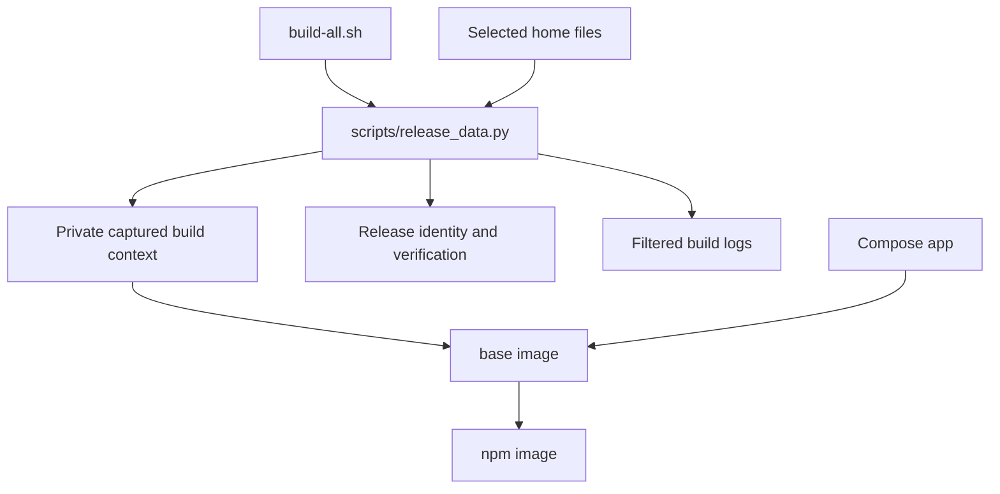

# Plan review

- [Plan review](#plan-review)
  - [Scores](#scores)
  - [Module Dependency Graph](#module-dependency-graph)
  - [Findings](#findings)
  - [Verification limits](#verification-limits)
  - [Recommendation](#recommendation)

**Mode:** Health Dashboard

**Scope:** Plan readiness: `tasks/16-copy-user-config-into-image/2-plan.md` at `6d250a7`, checked against the goal and affected build, Dockerfile, Compose, and test contracts. Not implementation health.

**Composite Score:** 100/100

**Trend:** Stable at 100; earlier reviews cover different scopes.

## Scores

- Code quality: skipped; no implementation diff.
- Architecture: 100/100. Uses the existing private build context and base/npm inheritance.
- Tech debt: 100/100. Covers permissions, cleanup, release fingerprints, authentication, and documentation without adding another build workflow.
- Test quality: 100/100. Plans isolated fake inputs, failure cases, changed-input checks, and updates to existing contract tests.

Weights: architecture `0.30 / 0.75`, debt `0.25 / 0.75`, tests `0.20 / 0.75`. Default balanced settings; no `.brooks-lint.yaml` found.

## Module Dependency Graph

Planned flow:

## Findings

No critical, warning, or suggestion findings in the plan.

The plan matches the goal. It removes only the intended mounts and unused build secret. Changed personal inputs participate in release checks, while publication authentication stays separate. Extractable credentials are an explicit user-selected tradeoff, not an overlooked protection.

## Verification limits

Reviewed the current capture, identity, build-argument, Dockerfile, and test seams. The existing suite has 148 Python test methods across seven files, mixing unit, contract, and fake-command integration checks. Native smoke runners are separate.

No tests, real builds, credential reads, or service requests were run. The scores assess the proposed changes, not working images. Actual Docker ownership, permissions, inheritance, and connectivity remain unverified until separately authorized checks.

## Recommendation

Ready for implementation through `@implement`. Keep the combined fingerprint deterministic over relative paths, contents, empty directories, and normalized permissions. Preserve the short plan and existing release safeguards.
