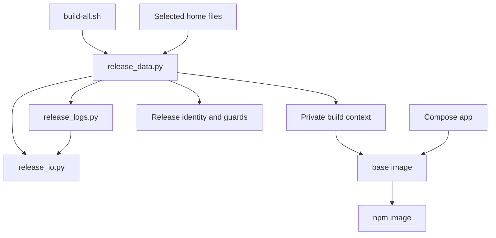

# Branch review

- [Branch review](#branch-review)
  - [Scores](#scores)
  - [Module Dependency Graph](#module-dependency-graph)
  - [Findings](#findings)
    - [Suggestion](#suggestion)
  - [Verification](#verification)
  - [Recommendation](#recommendation)

**Mode:** Health Dashboard

**Scope:** All 15 changed files on `16-copy-user-config-into-image`: base `main` at `ca9ba84` through `83788e4`. Default balanced settings; no `.brooks-lint.yaml` found.

**Composite Score:** 100/100

**Trend:** Stable at 100; the previous record assessed plan readiness, not implementation.

No blocking defects found. One minor test-maintenance suggestion remains.

## Scores

- Code quality: 100/100. Capture, permissions, snapshots, and release checks follow the existing workflow.
- Architecture: 100/100. Dependencies remain acyclic; base owns personal files and npm inherits them.
- Tech debt: 100/100. Bounds, authentication separation, fingerprints, documentation, and version metadata agree.
- Test quality: 99/100. One overly broad Compose assertion couples unrelated changes to browser tests.

Weights: code 25%, architecture 30%, debt 25%, tests 20%. The weighted result is 99.8, rounded to 100.

## Module Dependency Graph

## Findings

No critical or warning findings. Baking extractable credentials is the requested, documented tradeoff, not an accidental exposure introduced against the goal.

### Suggestion

**[T2] Test Brittleness — Browser test rejects unrelated mounts**

Symptom: `tests/test_playwright.py:54-55` bans every `create_host_path:` option and `${HOME}/` reference. An isolated reproduction added an unrelated cache mount with `create_host_path: false`; the browser-network test failed despite unchanged networking and no personal-file mounts.

Source: *The Art of Unit Testing* — Test isolation principle; *The Pragmatic Programmer* — Orthogonality.

Consequence: Future cache or other unrelated mount changes require editing a browser test. This is a local maintenance burden, not a current runtime failure.

Remedy: Keep this test focused on browser networking. Let `tests/test_penpot_mcp.py` check the absence of the three specific personal mounts, rather than banning all home paths or bind options.

## Verification

- Review reran all 17 new personal-file tests: passed. Checks cover captures, overrides, bounds, links, special files, permissions, fingerprints, stale images, retries, and filtering.
- `bash -n build-all.sh`, `bash build-all.sh --validate`, and `git diff main...HEAD --check`: passed.
- Confirmed the test-brittleness finding using a disposable Compose copy; no project files changed.
- Suite map by primary seam: 78 helper/config/filesystem contracts, 22 process/loader tests, and 65 fake-command workflows; 165 Python test methods total. Native smoke runners are separate and were not run.
- The earlier implementation run passed 164 of 165 tests. Its sole failure expects missing manual Dockerfiles and was reproduced against base `ca9ba84`. Review did not rerun the complete suite.
- No real credential reads, native builds, registry login, service access, or publication. Actual Docker ownership, copy behavior, and connectivity remain unverified.

## Recommendation

No blocking changes required from this review. Narrow the browser assertions when convenient. No fixes were applied; private-image access and credential revocation remain the operator's responsibility.
