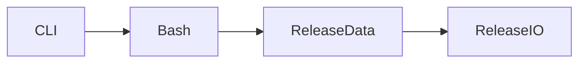

# Plan review

- [Plan review](#plan-review)

Health Dashboard for task 18: architecture 100, debt 95, tests 99, composite 98. No implementation diff yet.

Debt warning: the inventory transition leaves a same-version legacy tag ambiguous. A prior `v1.2.3` must not authorize publication of `1.2.3`. Reject the matching legacy Git tag or release even without the other record. Keep older releases readable and newer stable releases blocking.

Test suggestion: existing integration tests enter via the old command. Exercise the new entry point with explicit expected remote aliases and add migration collision checks. Unit tests and fake-service integration tests are appropriate; live end-to-end publication is outside this task.
