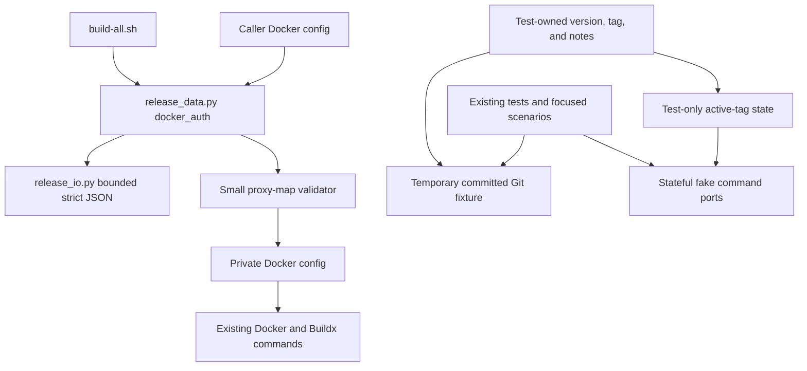

# Brooks-Lint Health Dashboard

- [Dashboard](#dashboard)
- [Module Dependency Graph](#module-dependency-graph)
- [Top Findings](#top-findings)
- [Coverage and Verification](#coverage-and-verification)
- [Recommendation](#recommendation)

## Dashboard

**Mode:** Health Dashboard

**Scope:** Plan readiness review of `tasks/2-fix-review-warnings/2-plan.md` against its goal, W1/W2 from the previous code review, and the current Docker-auth preparation, shell call sequence, and test fixtures/fake ports. This is not a new implementation or whole-project health assessment. No `.brooks-lint.yaml` exists; balanced defaults apply. Untracked user files are excluded.

**Composite Score:** 100/100

**Trend:** Previous dashboard score 97, current score 100 (+3). The previous score assessed implementation on task 1; the current score assesses a remediation plan. The difference is not evidence that executable code improved or that W1/W2 are fixed.

- Code Quality: 100/100. The proposed change contract is explicit and limited to W1/W2; no additional finding.
- Architecture: 100/100. Proxy preservation stays in the Docker configuration adapter and leaves publication policy unchanged; no additional finding.
- Tech Debt: 100/100. The plan avoids a new configuration framework, endpoint-selection algorithm, and unrelated refactoring; no additional finding.
- Test Quality: 100/100. Independent fixture metadata, active-tag fake targeting, alternate-version scenarios, and observable refusal assertions directly cover W2 and W1; no additional finding.

The proposed plan is the change under review, so all four dimensions are included. Each has zero deductions. Weighted calculation: `100 × 0.25 + 100 × 0.30 + 100 × 0.25 + 100 × 0.20 = 100`. Scores express the absence of identified plan-level gaps within this scope, not a guarantee of implementation correctness or operational safety.

**Verdict:** Ready for implementation within the stated scope. No blocking plan revisions identified.

## Module Dependency Graph

Proposed local changes preserve existing dependency directions. Proxy data remains private adapter input; test-owned version metadata does not become a production interface.

## Top Findings

No new Critical, Warning, or Suggestion finding was established in the plan. W1 and W2 remain existing implementation warnings until their fixes and regression tests are completed; they are not counted again as omissions from a plan that explicitly addresses them. S1 remains intentionally deferred under the goal's warning-only scope.

The following decisions make the plan actionable rather than merely repeating the previous review:

- `2-plan.md:21-26` specifies where proxy handling belongs, its allowed structure, null/empty behavior, supported fields, literal value preservation, private permissions, registry-auth exclusions, and failure ordering. Keeping the complete validated map delegates default/per-daemon semantics to Docker instead of introducing a competing endpoint resolver. This supports Orthogonality from *The Pragmatic Programmer* and adapter responsibility separation from *Clean Architecture*.
- `2-plan.md:30-34` replaces production-version coupling with explicit test-owned metadata committed before publication tests. Expected tags and fake failure targets derive from that fixture, not production parsing logic under test. This directly addresses Test Brittleness and Test Isolation from *xUnit Test Patterns* and *The Art of Unit Testing*.
- `2-plan.md:38-43` tests configuration preservation, credential exclusion, permissions, malformed input, zero publication effects, cleanup, and both successful and negative scenarios for two versions. Focused helpers avoid duplicating the entire suite while retaining meaningful side-effect assertions.
- `2-plan.md:47-57,70-75` preserves historical notes, limits changes to a patch release, distinguishes offline evidence from native readiness, and forbids publication or repair during verification. No speculative platform, toolchain, or recovery subsystem is introduced.

## Coverage and Verification

- Inspected `scripts/release_data.py:190-240`: the current adapter copies context/plugin settings but omits proxies. The proposed small validator/copy extension has a clear home and need not alter credentials or release-state guards.
- Inspected `build-all.sh:39-75`: private-auth preparation precedes startup classification, registry login, and staging builds. The plan's fail-before-publication requirement fits this existing sequence; it does not promise that the earlier builder bootstrap has no local effects.
- Inspected current fixture setup and fake HTTP routing: production metadata is copied before the temporary commit, and malformed fifth-image selection is hard-coded to the initial tag. The plan explicitly replaces both mechanisms and requires fixture metadata to be committed before source checks.
- Existing suite map from static inspection: 32 test methods in one module, comprising nine helper/data-focused tests and 23 shell-subprocess integration tests (13 local-contract and 10 publication). Remote Docker/curl/Git behavior uses fake ports; there are no native Docker or live-service E2E tests. The proposed additional tests do not exist yet, so their count, runtime, and results cannot be claimed.
- No tests, Docker commands, credential reads, native smoke checks, real builds, or publication operations were run during this plan review. Current code was inspected only as supporting evidence; implementation and `2-plan.md` remain unchanged.
- Strict rejection of unsupported proxy fields is an explicit compatibility policy, not an accidental silent drop. Its documentation and negative tests are required by the plan. Copying all validated endpoint entries into a private file is justified here because Docker owns their selection and proxy values may be sensitive.

## Recommendation

Proceed with W1/W2 implementation as planned, starting with focused proxy and fixture regressions, then run the complete suite on final files. Preserve the plan's private-data boundaries and native-readiness gate; do not infer real proxy forwarding from fake-port success. The plan needs no mandatory revision. Review the resulting implementation before treating the existing warnings as resolved, and leave S1 and unrelated user work untouched.
