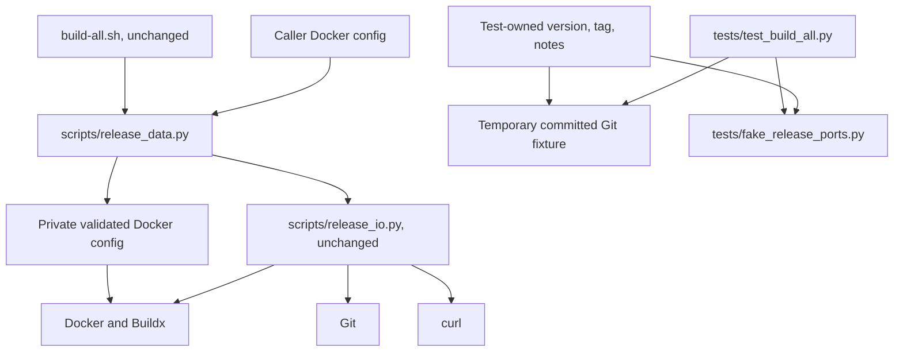

# Brooks-Lint Health Dashboard

- [Dashboard](#dashboard)
- [Module Dependency Graph](#module-dependency-graph)
- [Top Findings](#top-findings)
- [Resolution of Previous Warnings](#resolution-of-previous-warnings)
- [Verification and Test Suite Map](#verification-and-test-suite-map)
- [Accepted Tradeoffs and Limits](#accepted-tradeoffs-and-limits)
- [Recommendation](#recommendation)

## Dashboard

**Mode:** Health Dashboard

**Scope:** All nine files changed on `2-fix-review-warnings` relative to its actual parent branch `1-update-build-publish`, at merge base `91561241a47ef51f2b2b775e2c556328fc48ab02`, through implementation commit `daaa17f`. Reviewed the complete delta: README, root version, release documentation/notes, release configuration, Docker-auth adapter, test module/fake ports, and implementation record (303 additions, 30 deletions). Inherited task-1 implementation is supporting context, not a new change in this review. Untracked `command.md` and root `docker-compose.yml` are excluded. No `.brooks-lint.yaml` exists; balanced defaults apply.

**Composite Score:** 100/100

**Trend:** Stable at 100 against the immediately preceding dashboard record. That record assessed this task's plan, not executable changes; the equal scores do not establish an implementation-quality trend.

- Code Quality: 100/100. No new finding; proxy validation is small, explicit, and separate from publication state transitions.
- Architecture: 100/100. No new finding; Docker retains endpoint-selection responsibility, and registry credential isolation remains intact.
- Tech Debt: 100/100. No new finding within the changed scope; no new dependency, configuration framework, or recovery mechanism was introduced.
- Test Quality: 100/100. No new finding; fixtures own their release metadata and focused multi-version scenarios observe success/refusal effects.

All four dimensions have zero deductions. Weighted score: `100 × 0.25 + 100 × 0.30 + 100 × 0.25 + 100 × 0.20 = 100`. This is a scoped review score, not a certification that the whole project is defect-free or ready for native publication.

## Module Dependency Graph

The patch introduces no dependency cycle or upward dependency. Concrete Docker/Git/curl ports remain appropriate infrastructure at the existing release-orchestration boundary.

## Top Findings

No new Critical, Warning, or Suggestion findings were established in this branch delta. The previous W1 and W2 findings are addressed at the code/data-preservation and offline-regression levels described below. No implementation fixes were applied during this review.

## Resolution of Previous Warnings

- **W1 — Resolved for configuration preservation and isolation.** `scripts/release_data.py:190-203` validates the supported proxy-map shape, null/empty behavior, literal strings, and controls with generic errors. `:206-231` reads through the existing bounded strict loader, copies the complete validated map under `proxies`, starts with empty `auths`, excludes caller registry helpers, and enforces private directory/file modes. It does not merge defaults, guess endpoint mappings, expand values, or modify source config. The unchanged shell sequence prepares this private configuration before login and staging. This restores Orthogonality from *The Pragmatic Programmer* without changing release policy or introducing another endpoint resolver.
- **W1 regression evidence.** `tests/test_build_all.py:265-317,424-459,499-523` covers proxy preservation at login/all five fake builds, original-config immutability, permissions, helper exclusions, absent/null/empty settings, default/relative config paths, malformed/oversized/duplicate-key refusal, privacy, and cleanup after success/failure. Fake ports compare a synthetic proxy-map hash and record counts, not the values. This establishes the data boundary, not native forwarding or connectivity.
- **W2 — Resolved for fixture independence.** `tests/test_build_all.py:21-68` creates fixture-owned version/tag/notes before the initial temporary Git commit. Success and failure scenarios use those attributes, while malformed fifth-image routing uses test state rather than `v0.1.0`. Focused scenarios cover versions 1.2.3 and 2.4.6; a separate temporary source changes production-style metadata to 9.8.7 without changing fixture expectations. This addresses Test Brittleness and Test Isolation from *xUnit Test Patterns* and *The Art of Unit Testing*. A search of `tests/` found no remaining `0.1.0` references.
- **Version/documentation agreement.** Root `VERSION` is 0.1.1, configured notes point to `docs/releases/0.1.1.md`, and their heading matches. Historical 0.1.0 notes remain unchanged. README remains brief; dedicated docs explain proxy policy, sensitive values, refusal boundaries, and separately authorized native qualification.

## Verification and Test Suite Map

- Review rerun of `python3 -B -m unittest discover -s tests -v`: passed, 39 test methods in 292.709 seconds, including multi-version subtests and proxy success/failure scenarios.
- `bash -n build-all.sh`: passed.
- `bash build-all.sh --validate`: passed against current project metadata, without credentials, Docker, or network operations.
- `git diff --check`: passed before writing review artifacts; checked again before commit.
- Suite map: 39 test methods in one test module, including 11 helper/data-focused tests and 28 shell-subprocess integration tests (15 local-contract and 13 publication). Multi-version and malformed-configuration cases add subtests, not duplicated test classes. Temporary real Git repositories support object/source checks; remote Git, Docker, and curl behavior use fake ports. There are no native Docker or live-service E2E tests.
- This integration-heavy distribution is justified by the workflow's side-effect ordering and refusal contracts; fake interactions are observable command behavior, not automatically mock abuse. Expected proxy maps and fixture metadata are test-owned rather than derived from the production validator under test.
- No real image builds, registry login/pushes, Git remote mutations, release creation, user credential reads, dependency installation, or native readiness checks were performed. Only this review document and score history are changed by the review stage.

## Accepted Tradeoffs and Limits

- Strict supported-field validation is an explicit, documented compatibility policy. Copying all validated per-daemon entries delegates selection to Docker while keeping potentially credential-bearing values inside private configuration storage.
- Earlier builder bootstrap can have local effects; the patch and documentation promise refusal before publication effects, not a completely effect-free publication preflight. Offline `--validate` remains separate and does not inspect caller Docker config.
- Proxy forwarding, native plugin/context/TLS behavior, actual build networking, and production publication remain unverified. The documented opt-in gate appropriately distinguishes those claims from passing fake-port tests.
- Existing Dockerfile-header suggestion S1 is unchanged, inherited from the parent branch, and explicitly deferred by this task. It is neither silently marked fixed nor counted as a newly introduced finding. Publication identity/retry/rollback policies and unrelated user work remain unchanged.

## Recommendation

No additional implementation changes are requested by this scoped review. Accept the W1/W2 remediation subject to the recorded offline verification, keep S1 tracked separately, and retain the native-readiness gate before operational use. Do not interpret this score or review commit as authorization to publish images, mutate remote tags, or repair prior release state.
