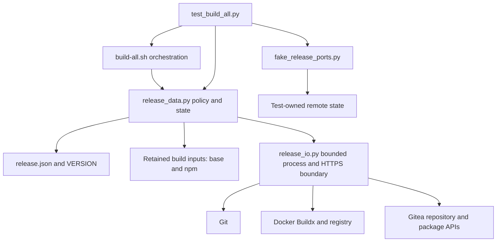

# Brooks-Lint Health Dashboard

- [Dashboard](#dashboard)
- [Module Dependency Graph](#module-dependency-graph)
- [Test Suite Map](#test-suite-map)
- [Findings](#findings)
  - [Critical](#critical)
  - [Warning](#warning)
- [Recommendation](#recommendation)

**Mode:** Health Dashboard

**Scope:** Plan readiness for `tasks/3-release-latest-package-links/2-plan.md`, checked against `1-goal.md`, the current release scripts, configuration, Dockerfile/Compose references, tests, and the public Gitea 1.24 API implementation. This is not an implementation-health or live-server certification.

**Composite Score:** 92/100

**Trend:** 100 → 92 versus the latest Health Dashboard record; different scope, so this does not establish implementation regression.

The plan matches the updated two-image build/release goal, but package-association evidence needs stronger permission and capability rules before implementation.

## Dashboard

- Code Quality: not scored; no implementation diff exists. The plan's proposed edits were checked for scope and change propagation.
- Architecture: 85/100; one Critical finding concerning permission-filtered association evidence.
- Tech Debt: 95/100; one Warning concerning the undefined capability/absence contract.
- Test Quality: 100/100; no separate finding against the proposed test strategy. Tests must incorporate the acceptance cases attached to both findings below.
- Scoring uses balanced deductions: Critical −15, Warning −5. With Code Quality omitted, the composite is `(85 × 0.30 + 95 × 0.25 + 100 × 0.20) / 0.75 = 92.33`, rounded to 92. Each finding is charged to one dimension only.
- No `.brooks-lint.yaml` exists; defaults apply. No implementation changes, native builds, publication, credential reads, or calls to the deployed Gitea instance were performed. Existing tests were inspected, not executed.

## Module Dependency Graph

The proposed shared two-image graph removes the need for mode-specific graphs. Keeping association policy in `release_data.py` and transport in `release_io.py` preserves the existing boundary. No new dependency cycle or speculative subsystem is proposed.

## Test Suite Map

- Current `tests/test_build_all.py`: 39 test methods; 15 local-contract, 13 publication, and 11 data-boundary tests.
- Local/publication tests exercise the Bash entry point through test-owned Git repositories and fake Git/Docker/curl ports. Data-boundary tests exercise validation and transport seams; these categories are not a claim of 39 unit tests.
- No live Gitea/UI end-to-end tests were identified. The plan correctly separates offline acceptance from separately authorized publication and Packages-page verification.
- Proposed coverage includes two-image builds, four alias promotions, excluded-image noninterference, staged retry, package links, lost responses, refusals, and read-only completed retries. Fake ports are justified for deterministic destructive-boundary tests, but their response semantics must match the server contract.

## Findings

### Critical

**R6 — Permission-filtered null is not proof that a package is unlinked.**

- Location: `2-plan.md:38-45,54,88`; [Gitea package conversion](https://github.com/go-gitea/gitea/blob/release/v1.24/services/convert/package.go), `ToPackage`.
- Symptom: The plan proposes reading a package's repository field, linking an unlinked package, and refusing foreign links. Gitea's converter emits `repository: null` both when no repository is associated and when the caller lacks any unit access to the associated repository. Reading `dev/dev-docker` successfully does not prove access to another repository. The plan does not define how these states are distinguished.
- Source: *Domain-Driven Design* — anti-corruption boundaries; *Code Complete* — defensive programming. A permission-filtered API representation must not be treated as authoritative mutation policy.
- Consequence: A package linked to an inaccessible repository could be classified as unlinked. Calling the link endpoint can replace its existing association, violating the plan's no-reassignment guarantee even when the immediate re-read also returns null.
- Remedy: Define an authoritative visibility requirement before allowing a null association to authorize linking. For the configured user-owned namespace, one narrow option is to require a verified authenticated package-owner identity and sufficient effective repository visibility; prove this against the supported server's authorization behavior rather than trusting the login setting. If complete visibility cannot be established, classify null as unknown and refuse mutation. Do not add unlink or a force-reassignment fallback.
- Required acceptance: Add realistic permission-filtered package fixtures with an actual foreign association but `repository: null`. The run must refuse before publication writes and must never link the package. Separately test a genuinely unlinked package with the verified authority needed to link it safely.

### Warning

**R1 — Capability detection and absence evidence remain unspecified.**

- Location: `2-plan.md:38-41,50,54,90`; [Gitea package API](https://github.com/go-gitea/gitea/blob/release/v1.24/routers/api/v1/packages/package.go), `GetLatestPackageVersion`, `ListPackageVersions`, and `LinkPackage`.
- Symptom: The plan requires confirming deployed API support and accepting absence only on a supported endpoint, but does not choose a capability check or exact absence rule. A `404` from `/-/latest` alone cannot establish both support and package absence. The current fake port has no package API contract, so new fixtures could accidentally encode a stronger guarantee than the server provides.
- Source: *A Philosophy of Software Design* — information hiding; *Working Effectively with Legacy Code* — characterization at external seams.
- Consequence: Different implementations can either reject every fresh package or treat unsupported/hidden resources as absent and begin staging writes. The stated unsupported-API and permission tests lack a precise expected contract.
- Remedy: Specify the supported server/API baseline and concrete read-only preflight sequence. Define repository identity and `has_packages` checks, authenticated package visibility, strict response shapes, and how package absence is proven independently of an ambiguous `404`. A bounded successful exact-name version listing returning an empty array can be part of this proof on a characterized server; do not equate a failed listing with an empty result. Record the chosen strategy in the plan and derive fake responses from that contract.
- Required acceptance: Distinguish an unsupported route, a permission-hidden resource, a successful empty package listing, a valid existing package, and malformed evidence. Unsupported/unknown cases must stop before login, staging push, link, Git-tag push, or release creation. Confirm `has_packages` is a real boolean and package owner/type/name and repository identity match exactly.

## Recommendation

Revise the package evidence contract before implementation. Keep the shared `base` → `npm` graph, retained excluded Dockerfiles, existing release guards, and offline/live verification split. Both findings concern the new external association boundary, not a reason to redesign the release engine. This review changes neither `2-plan.md` nor implementation code; resolve the findings in a subsequent plan update.
