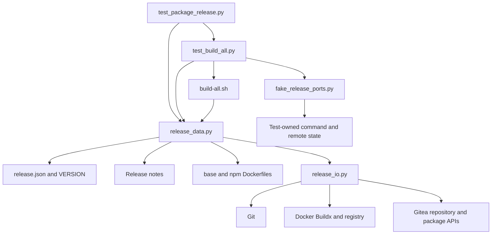

# Brooks-Lint Health Dashboard

- [Dashboard](#dashboard)
- [Module Dependency Graph](#module-dependency-graph)
- [Test Suite Map](#test-suite-map)
- [Findings](#findings)
- [Verification](#verification)
- [Recommendation](#recommendation)

**Mode:** Health Dashboard

**Scope:** All 16 changed files on `3-release-latest-package-links`, relative to merge base `main` (`3f3096c32a2894544466759bf7454c4760e2f5c4`) through implementation commit `05f20fa`. The branch contains one implementation commit. The checkout was clean before review; this report and its history record are not implementation changes under review.

**Composite Score:** 100/100

**Trend:** 92 → 100 against the latest Health Dashboard record. That record assessed the plan, not this implementation; the difference is not a like-for-like runtime health trend.

No actionable defects or maintainability findings were established in the branch changes. Offline acceptance does not certify live publication.

## Dashboard

- Code Quality: 100/100. Renames and exclusions are coordinated within one release feature, not unrelated change propagation. Boundary checks fail closed and keep remote response values out of diagnostics.
- Architecture: 100/100. Bash sequences mutations, Python owns release/package policy, and `release_io.py` retains the bounded transport boundary. No introduced module cycle or inconsistent dependency direction was found.
- Tech Debt: 100/100. One two-image graph drives both modes. Exact server-version support and owner-only authority are deliberate reviewed constraints, not speculative extensibility. No additional finding was established across R1–R6.
- Test Quality: 100/100. Scenario names, isolated fixtures, stateful side-effect assertions, and focused evidence checks cover the changed behavior. No actionable T1/T2 issue was found; command-order assertions protect publication safety rather than private implementation wiring.
- Balanced scoring applies, with zero Critical, Warning, or Suggestion findings. Weighted composite: `100 × 0.25 + 100 × 0.30 + 100 × 0.25 + 100 × 0.20 = 100`.
- No `.brooks-lint.yaml` exists; defaults apply. No fixes were implemented during review.

## Module Dependency Graph

The graph shows imports, command orchestration, and test-fixture dependencies, not claims that the transport module contains release policy. Android, Tauri, and Switchboard Dockerfiles remain manual inputs outside the automated graph.

## Test Suite Map

- 61 test methods total. `LocalContractTests` has 15, `PublicationTests` has 13, and `PackagePublicationTests` has 14: 42 command-boundary integration tests using isolated repositories and fake external ports.
- `DataBoundaryTests` has 11 and `PackageEvidenceTests` has 8: 19 boundary/helper tests, including mocked HTTP, real temporary files, and bounded subprocess checks. These are mixed tests, not a claim of 19 pure unit tests.
- No live Docker/Gitea/UI end-to-end tests were identified or run. The integration-heavy shape is justified for this shell-driven publication workflow, and fast evidence tests separately cover strict parsing and authority rules.
- The full suite's recorded 411.701-second run is below the guide's ten-minute warning threshold. Native behavior and live UI visibility remain separate operational gates, not inferred from fake-port results.

## Findings

No Critical, Warning, or Suggestion findings were established in the reviewed changes.

- **Build/release scope:** `scripts/release.json`, `scripts/release_data.py:27-32,69-99,643-676,816-818`, and `build-all.sh:64-79` consistently select only `base` and `npm`. Retained Dockerfile parent defaults, the Compose reference, version `0.1.2`, and its notes path agree with the goal. Excluded-image noninterference checks include tag digest/predecessor sets and fixtures without the excluded Dockerfiles.
- **Plan review R6:** `scripts/release_data.py:325-368,371-433` establishes authenticated individual-owner authority before interpreting explicit null. Principal/namespace/registry-login agreement, exact repository identity, boolean status/permission fields, and captured authority prevent delegated or ambiguous evidence from granting link permission. The hidden-null regression refuses before publication writes.
- **Plan review R1:** Exact characterized versions, successful authorized exact-name listings, bounded pagination, explicit repository fields, unique version identities, and consistent package-wide associations now define the external evidence contract. Unsupported, permission-hidden, failed, malformed, and oversized reads are refusals rather than absence.
- **Mutation/retry safety:** `scripts/release_data.py:436-460,592-640,743-752,866-883` and `build-all.sh:80-106` place verified links before Git-tag publication and require associations during subsequent guards. Prerequisite transport failures are converted to non-reconcilable refusals; attempted link transport failures can be confirmed only through fresh exact evidence. Correct existing links are skipped, completed retries do not repair missing links, and no unlink/force-reassignment path was introduced.
- **Documented tradeoffs:** Public-source characterization of `28.2.0` is an allowed extension of the plan's initial `1.24.7` contract. The documented server services refuse existing links; the earlier plan review's overwrite assumption was corrected rather than carried into implementation. Single-operator exclusion remains necessary; no cross-service atomicity or arbitrary fork compatibility is claimed.

## Verification

- During this review, `bash -n build-all.sh`, `bash build-all.sh --validate`, and `git diff --check main...HEAD` passed.
- During this review, `PYTHONPATH=tests python3 -B -m unittest test_package_release.PackageEvidenceTests -v` passed all 8 tests in 0.611 seconds.
- During this review, a focused command running `test_both_characterized_server_contracts_publish`, `test_failed_second_link_retry_reuses_images_and_first_link`, and `test_two_image_release_and_completed_read_only_retry` passed all 3 tests in 111.305 seconds. Their subcases exercise both supported server versions, two fixture release versions, staged retry reuse, and completed read-only retries.
- The full 61-test run passed in 411.701 seconds immediately before implementation commit `05f20fa`, as observed in this session and recorded in `4-implemented.md`. It was not rerun in full during this review; implementation code has not changed since that run.
- No native builds, registry login/push, Git-tag push, release creation, deployed package links, credential inspection, or live UI verification were performed during review. Review writes are limited to this report and the health-history entry.

## Recommendation

No code remediation is requested before merge based on this scoped review. Preserve the owner-authority, bounded-evidence, and no-repair guarantees in future changes. Before real publication, separately authorize and complete the documented native-readiness and live acceptance checks, then verify `base` and `npm` on the `dev/dev-docker` Packages page. This score does not certify production readiness or already-published package visibility.
