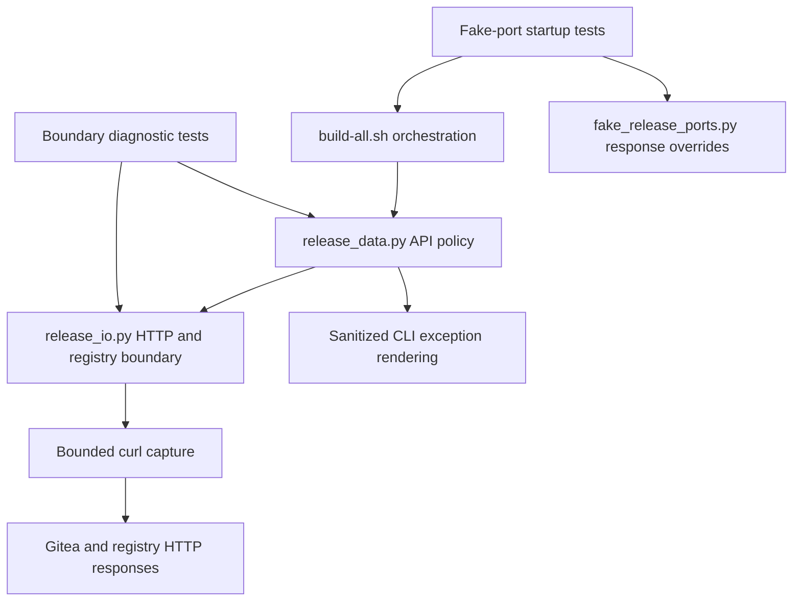

# Brooks-Lint Health Dashboard

- [Dashboard](#dashboard)
- [Module Dependency Graph](#module-dependency-graph)
- [Test Suite Map](#test-suite-map)
- [Findings](#findings)
- [Review Evidence](#review-evidence)
- [Recommendation](#recommendation)

**Mode:** Health Dashboard

**Scope:** Plan readiness for `tasks/4-show-http-error-status/2-plan.md`, checked against `1-goal.md`, current HTTP/status guards, exception handling, Bash release sequencing, existing test seams, and release conventions. This is not an implementation or production-readiness assessment.

**Composite Score:** 100/100

**Trend:** Stable at 100 versus the latest Health Dashboard record. That record reviewed another task's implementation; these scopes are not directly comparable.

The plan is actionable and keeps the requested diagnostic change separate from release policy and permission repair.

## Dashboard

- Code Quality: not scored; no implementation diff exists. The proposed edits are limited to existing status guards and relevant tests/documentation.
- Architecture: 100/100. Parsing remains in `release_io.py`; API-specific acceptance remains with its callers. No new dependency direction, logging subsystem, or exception hierarchy is proposed.
- Tech Debt: 100/100. Simple formatting at existing guards avoids speculative machinery. The plan explicitly preserves accepted statuses, normal protocol control flow, transport/resource failure precedence, and release identity rules.
- Test Quality: 100/100. Planned assertions cover numeric diagnostics, privacy, caller-level refusals, malformed/transport failures, and zero publication effects without freezing unrelated wording or trap repetition.
- Balanced scoring applies with zero Critical, Warning, or Suggestion findings. With Code Quality omitted, the composite is `(100 × 0.30 + 100 × 0.25 + 100 × 0.20) / 0.75 = 100`.
- No `.brooks-lint.yaml` exists; defaults apply. No implementation code or plan content was modified during this review.

## Module Dependency Graph

The planned change exposes only the parsed numeric status at the existing refusal boundary. It does not require request URLs, remote response text, or transport implementation details to enter higher-level messages.

## Test Suite Map

- Existing suite: 61 test methods. Local/publication/package-publication classes contain 42 command-boundary integration tests; data-boundary/package-evidence classes contain 19 mixed helper/boundary tests. These categories do not imply 19 pure unit tests.
- Existing fake HTTP response overrides cover package failures including `401`, `403`, `404`, `302`, and `500`. The plan extends these checks to assert the missing diagnostic code and retained zero-write behavior.
- Planned focused tests mock `capture`, not `http`, when exercising the actual HTTP parser. Separate caller tests cover transport-allowed statuses rejected by a particular API contract, including package-link `200` and release-create `404`.
- No live end-to-end verification is needed to establish this message-only behavior. The plan correctly prohibits production requests, credentials, real builds, publication, or package association as test activity.

## Findings

No Critical, Warning, or Suggestion findings were established against the plan.

- `2-plan.md:20-25` addresses both the generic transport allowlist refusal and the caller-level guards that otherwise discard accepted `401`/`404` status values. It preserves normal registry challenge/absence behavior and avoids misclassifying JSON, identity, or digest failures as status failures.
- `2-plan.md:21,25,29-33` limits interpolation to parsed numeric codes, retains sanitized non-status failures, and tests secret non-disclosure. Status refusals remain `Refusal`, preserving the distinction from `CommandFailed` that controls lost-response reconciliation.
- `2-plan.md:35-46,56-61` ties the change to the existing patch-version/notes convention, calls for offline regression checks, and explicitly excludes endpoint disclosure, credential changes, permission repair, repeated ERR-trap cleanup, and remote release repair. These exclusions match the latest goal rather than leaving required implementation work unresolved.

## Review Evidence

- Inspected `scripts/release_io.py:150-180,183-219`: the parsed status is available before the generic allowlist refusal, while registry authentication/evidence acceptance has separate guards. This supports a small wording-only change without expanding protocol permissions.
- Inspected `scripts/release_data.py` HTTP-call/status-check sites in `api_read`, `link_package`, `inventory_scan`, and release creation, plus `prewrite` and final exception rendering. The plan identifies all direct status-acceptance checks in these paths.
- Inspected `build-all.sh:46,59-61,81-104`: nested failure reporting and transport-reconciliation sequencing are existing behaviors. The plan appropriately leaves sequencing unchanged and does not mistake repeated diagnostics for repeated publication attempts.
- Inspected current package-error overrides and boundary tests for capture limits, registry challenge restrictions, and failed prerequisite reads. Existing seams support the proposed tests without production-only hooks.
- This was a read-only inspection of implementation and tests. No tests or live requests were run for this plan review. The future diagnostic behavior remains unimplemented and unverified until the implementation stage.

## Recommendation

Proceed with implementation as planned. Keep changes diagnostic-only and verify both transport-level and caller-level status refusals before claiming the user's opaque error is resolved. A visible status code will aid diagnosis; it will not establish the failing endpoint or fix the underlying server condition. No plan revision is required by this review.
