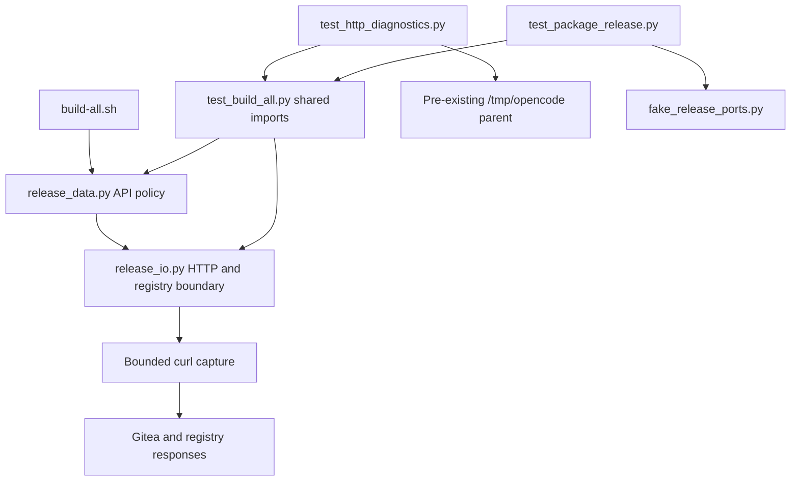

# Brooks-Lint Health Dashboard

- [Dashboard](#dashboard)
- [Module Dependency Graph](#module-dependency-graph)
- [Test Suite Map](#test-suite-map)
- [Findings](#findings)
  - [Warning](#warning)
- [Verification](#verification)
- [Recommendation](#recommendation)

**Mode:** Health Dashboard

**Scope:** All 10 changed files on `4-show-http-error-status`, from merge base `main` (`b7c7db0a3cc47edb6b98f8084e6b20e9645996d5`) through implementation commit `ff6e8da`. The branch contains one implementation commit and was clean before review. This report and the health-history entry are review artifacts, not implementation changes.

**Composite Score:** 99/100

**Trend:** 100 → 99 versus the latest Health Dashboard record. The previous record assessed this task's plan; this is not a like-for-like production-health comparison.

The production changes preserve existing release behavior, but the new test fixture introduces a harness-specific filesystem prerequisite.

## Dashboard

- Code Quality: 100/100. Production changes are limited to seven existing refusal messages. No change-propagation or cognitive-load finding was established in these edits.
- Architecture: 100/100. Status parsing stays in the transport boundary; API-specific acceptance remains with callers. No new production dependency or cycle is introduced.
- Tech Debt: 100/100. Direct formatting avoids a new logging framework or exception hierarchy. The status allowlist, refusal types, mutation sequencing, and protocol branches are unchanged.
- Test Quality: 95/100. One Warning, W1, covers the new fixture's dependence on a pre-existing `/tmp/opencode` directory. Other focused diagnostic/privacy checks passed.
- Balanced scoring charges W1 once to Test Quality: `100 × 0.25 + 100 × 0.30 + 100 × 0.25 + 95 × 0.20 = 99`. No Critical or Suggestion findings were established.
- No `.brooks-lint.yaml` exists; defaults apply. No fixes were applied during review.

## Module Dependency Graph

The pre-existing temporary parent is a test-environment dependency, not a production requirement. The graph does not imply that mocked HTTP tests make live requests.

## Test Suite Map

- 72 test methods total: 15 local-contract, 13 publication, 14 package-publication, 11 data-boundary, 8 package-evidence, and 11 new HTTP-diagnostics tests.
- The first three classes provide 42 command-boundary integration tests using isolated repositories and fake external commands. The other 30 are mixed helper/boundary tests; this is not a claim that all 30 are pure unit tests.
- New diagnostics tests exercise the actual HTTP parser with mocked capture, caller refusals, malformed/transport/resource failures, registry challenge/absence control flow, and sensitive-data non-disclosure. The existing startup integration case now checks status-bearing stderr and zero publication effects.
- Assertions generally verify observable error content, exception semantics, and side effects without freezing unrelated message text or Bash trap counts. No additional T1/T2 finding was established beyond W1. No live Docker/Gitea/UI end-to-end tests were run.

## Findings

### Warning

**W1 — T1: New diagnostic tests require a harness-owned temporary directory.**

- Location: `tests/test_http_diagnostics.py:12-16`, especially `tempfile.TemporaryDirectory(dir="/tmp/opencode")` at line 14. Compare the portable `tempfile.TemporaryDirectory()` fixture in `tests/test_build_all.py:25-28`.
- Symptom: Every new diagnostic test creates its fixture under an absolute parent that the tests neither create nor declare as a project prerequisite. `/tmp/opencode` is pre-created in this agent environment, but a normal developer checkout or CI runner need not have it. Supplying a valid alternative `TMPDIR` does not change the explicitly selected parent.
- Source: *xUnit Test Patterns* — Mystery Guest; *The Art of Unit Testing* — test isolation. Test success depends on external filesystem setup outside the fixture's ownership.
- Consequence: If that directory is absent or unwritable, all 11 new tests error during `setUp` before checking any diagnostic behavior. Passing the suite in this harness does not establish that the documented offline verification command works in an ordinary environment.
- Remedy: Use the existing portable `TemporaryDirectory()` convention and select this harness's approved parent through the test invocation environment, or create an explicitly test-owned portable parent. Do not turn a shared `/tmp/opencode` directory into a new mandatory project setup step. Add a regression showing the diagnostic tests work without that harness parent and with an ordinary writable temporary-directory selection.
- Evidence: With filesystem absence simulated only for child-directory creation under `/tmp/opencode`, all 11 diagnostic tests produced `FileNotFoundError` in `setUp`. The shared directory was not deleted, renamed, or modified; no implementation or test source was changed for the probe.

## Verification

- Reviewed the complete branch diff, including production messages, new/changed tests, README, guide, version/notes metadata, and `4-implemented.md`.
- During review, all 11 focused HTTP diagnostic tests passed in 0.011 seconds in the current prepared harness. The fake startup HTTP-error/unsupported-version integration test passed in 11.906 seconds, including status-code and zero-write assertions.
- The missing-parent fault-injection probe reproduced 11 setup errors, establishing W1 without altering the filesystem prerequisite or repository code.
- During review, `bash -n build-all.sh`, `bash build-all.sh --validate`, and `git diff --check main...HEAD` passed. AST comparison against `main` confirmed both production Python modules differ only in `require` message arguments; all other code structure and constants match.
- The full 72-test suite passed in 396.526 seconds immediately before `ff6e8da`, as observed in this session and recorded in `4-implemented.md`. It was not rerun in full during review. That result is valid for this prepared environment and does not negate W1.
- No production credentials, APIs, image builds, registry login/push, source/tag push, release creation, or package association were used during review. Review writes are limited to this report and its history entry.

## Recommendation

Resolve W1 before merging so the new regression coverage is portable. No production diagnostic defect was established: numeric codes are inserted only at existing status refusals, sensitive metadata remains excluded, and release policy is unchanged. The underlying server error, failing endpoint, and live publication remain unverified; this change is diagnostic-only. This review does not implement the recommended test-fixture fix.
