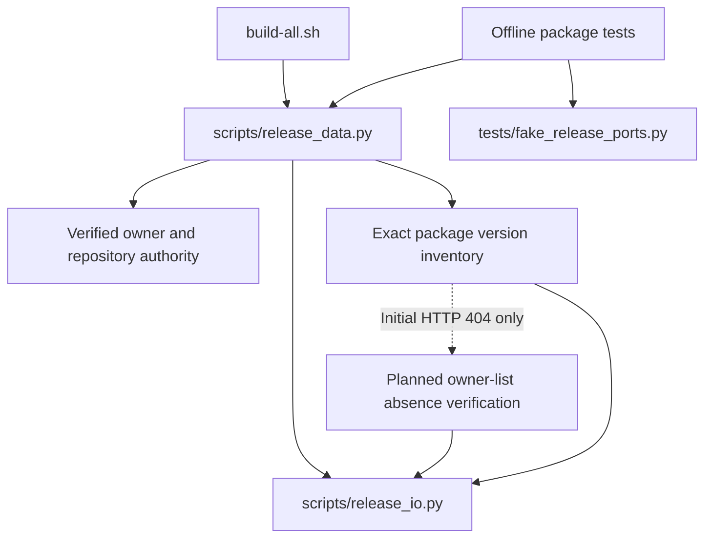

# Brooks-Lint Health Dashboard

- [Brooks-Lint Health Dashboard](#brooks-lint-health-dashboard)
  - [Dimension Scores](#dimension-scores)
  - [Module Dependency Graph](#module-dependency-graph)
  - [Test Suite Map](#test-suite-map)
  - [Top Findings](#top-findings)
  - [Evidence And Limits](#evidence-and-limits)
  - [Recommendation](#recommendation)

**Mode:** Health Dashboard

**Scope:** Plan readiness: `tasks/5-fix-first-publication/2-plan.md`, checked against `1-goal.md`, the release entry point, package inventory/guards, transport boundaries, existing package tests, and pinned upstream API/search behavior. This is not an implementation health assessment.

**Composite Score:** 100/100

**Trend:** Previous Health Dashboard score was 99; this score is 100 (+1). The previous entry reviewed branch implementation, so this is not evidence of a codebase quality improvement.

**Verdict:** Approved for implementation, with the plan's API-contract verification gate retained. No blocking findings.

## Dimension Scores

- Code Quality: 100/100. The proposed change is localized to package evidence handling, fixtures, and related documentation. It does not broaden generic API success rules or release mutation permissions.
- Architecture: 100/100. Shell orchestration remains unchanged; package policy stays in `release_data.py` and bounded HTTPS remains in `release_io.py`. The proposed helper absorbs the special initial-404 case without exposing new protocol policy to unrelated callers.
- Tech Debt: 100/100. The plan distinguishes absent visible versions from nonexistent package records, preserves internal-only conflicts, and rejects contradictory evidence. The extra inventory path addresses an observed API-version difference rather than a speculative feature.
- Test Quality: 100/100. The plan corrects the inaccurate missing-package fake, covers both supported contracts, asserts publication outcomes and forbidden effects, and retains failure/retry safeguards.

All four plan dimensions were evaluated with balanced deductions. No findings means no deductions: `100 × 0.25 + 100 × 0.30 + 100 × 0.25 + 100 × 0.20 = 100`. Code Quality evaluates the proposed plan changes, not an implementation diff.

## Module Dependency Graph

The fallback remains an evidence source, not a mutation stage. Fresh guards and required-link checks still own permission to advance publication.

## Test Suite Map

- Existing focused integration coverage: 14 publication tests in `PackagePublicationTests`, exercising the release script through stateful fake external commands.
- Existing focused evidence coverage: eight tests in `PackageEvidenceTests`, isolating package-policy behavior with patched HTTP or guard seams. These share the release fixture but do not contact Gitea.
- Planned additions: first publication under each supported API contract, mixed existing/missing packages, owner-search pagination and near matches, contradictory evidence, malformed or inaccessible resources, resource limits, and no-write assertions.
- Native end-to-end publication: deliberately excluded from implementation validation. Offline passing results must not be presented as proof of real registry or Buildx readiness.

The split is appropriate for the risk: detailed evidence cases belong at the isolated policy boundary; a smaller integration set proves staging, linking, aliases, tag/release completion, and read-only retries. No test-ratio or runtime judgment is inferred from this plan review.

## Top Findings

No Critical, Warning, or Suggestion findings in the reviewed plan. The following safeguards are already explicit requirements, not unresolved findings:

- An initial named-package 404 cannot grant absence authority by itself; the independently authorized owner search must succeed through a terminal empty page.
- An exact target discovered in the fallback contradicts the failed named-package read and causes refusal rather than adoption.
- Errors after an observed version, authority drift, required-link absence, and lost-response uncertainty remain refusals.
- Shared budgets and sanitized diagnostics apply to the added reads; no cleanup, reassignment, rollback, or live publication is authorized.

## Evidence And Limits

- The plan matches the recorded first-publication goal and the existing `startup`, `package_inventory`, `package_association`, `link_package`, and `guard` responsibilities.
- Upstream `v1.24.7` and `v28.2.0` package middleware/list handlers inspected during planning show the named-package resolution difference. The existing fake's unconditional empty list hides the newer server's missing-package 404.
- This review additionally inspected `models/packages/package_version.go` and `routers/api/v1/api.go` at both pinned tags. Search conditions include owner ID, package type, case-folded name filtering, and internal-version selection. The owner listing is protected by package scopes, owner assignment, package read access, and public-only token checks; failed access is not a successful empty inventory.
- Source references: [v1.24.7 package search](https://github.com/go-gitea/gitea/blob/v1.24.7/models/packages/package_version.go), [v28.2.0 package search](https://github.com/go-gitea/gitea/blob/v28.2.0/models/packages/package_version.go), [v1.24.7 API routing](https://github.com/go-gitea/gitea/blob/v1.24.7/routers/api/v1/api.go), and [v28.2.0 API routing](https://github.com/go-gitea/gitea/blob/v28.2.0/routers/api/v1/api.go).
- These checks support the design but do not replace the plan's required verification of search/conversion behavior and contract fixtures before changing publication authority. The deployed server was not authenticated or probed.
- No `.brooks-lint.yaml` exists; default risks and balanced scoring apply. The scan considered R1–R6 and test clarity/brittleness, plus the concrete fake-contract coverage risk. No implementation code changed, and tests were not run for this document-only review.

## Recommendation

Implement the plan in its stated order: establish the pinned contract, add the narrow absence verifier, correct the fake and regression tests, then update documentation and run offline checks. Preserve the explicit stop-and-revise condition if source inspection cannot establish complete owner-search evidence. No plan revision or broader refactoring is required before implementation.
