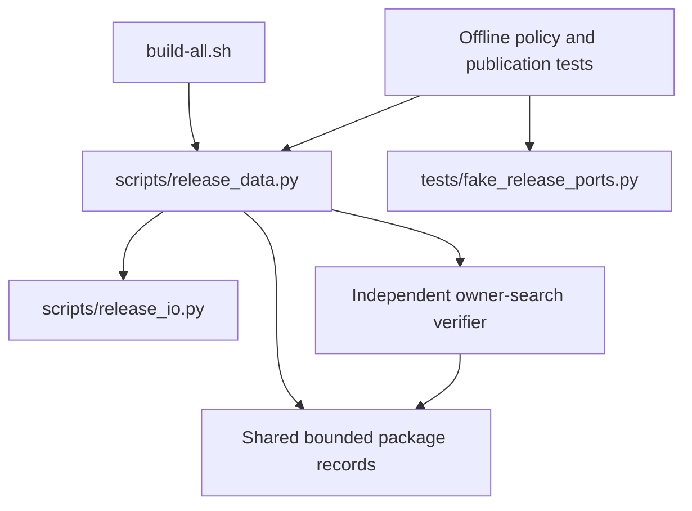

# Brooks-Lint Health Dashboard

- [Brooks-Lint Health Dashboard](#brooks-lint-health-dashboard)
  - [Dimension Scores](#dimension-scores)
  - [Module Dependency Graph](#module-dependency-graph)
  - [Test Suite Map](#test-suite-map)
  - [Top Findings](#top-findings)
  - [Verification And Limits](#verification-and-limits)
  - [Recommendation](#recommendation)

**Mode:** Health Dashboard

**Scope:** All nine changed files on `5-fix-first-publication` relative to its base branch, local `main`: `403105e...8725e67`. The merge base is `403105e528d3039f63ed017ba66a2143b70c9376`. Reviewed release policy, fixtures/tests, README, release documentation, version/configuration updates, and the implementation record. Supporting inspection included unchanged transport, authority, and mutation guards. No `.brooks-lint.yaml` exists; default risks and balanced scoring apply.

**Composite Score:** 100/100

**Trend:** Stable at 100 compared with the previous Health Dashboard entry. That entry assessed plan readiness rather than implementation, so this is not a longitudinal codebase quality measurement.

**Verdict:** No blocking defects or actionable decay findings in the branch changes. Approved within the documented offline verification limits.

## Dimension Scores

- Code Quality: 100/100. `api_read` still requires HTTP 200. Only the first exact package-list page can invoke independent absence verification on HTTP 404; later-page failures remain refusals. Extracted record iteration keeps validation and inventory limits in one place.
- Architecture: 100/100. The change stays inside release evidence policy and test boundaries. `build-all.sh` still owns mutation order, `release_data.py` owns classification/guards, and `release_io.py` owns bounded authenticated transport. No new dependencies or cycles were introduced.
- Tech Debt: 100/100. Absence is explicitly limited to matching non-internal versions, not all possible package records. Near matches are validated without association adoption; exact case-normalized matches contradict the failed exact read. No generic 404 acceptance, repair mechanism, or speculative abstraction was added.
- Test Quality: 100/100. The fixtures now model the server-version difference that caused the live failure. Tests verify publication outcomes, private diagnostics, inaccessible or contradictory evidence, terminal pagination, shared limits, read-only retries, and refusal after staged packages disappear.

All four dimensions apply to this branch diff. With no findings, balanced deductions are zero: `100 × 0.25 + 100 × 0.30 + 100 × 0.25 + 100 × 0.20 = 100`.

## Module Dependency Graph

`Records` and `Absence` are functions within `release_data.py`, not new modules. The graph separates their responsibilities without implying a dependency-layer redesign.

## Test Suite Map

- Isolated policy/boundary tests: 39 methods, comprising 11 data-boundary tests, 11 HTTP diagnostic tests, and 17 package-evidence tests. Some reuse a temporary repository fixture; they do not contact live services.
- Offline command integration tests: 47 methods, comprising 15 local-contract tests, 13 general publication tests, and 19 package-publication tests. They execute shell orchestration against stateful fake external commands.
- Native end-to-end tests: none. The documented readiness checklist remains separate.
- The total is 86 test methods, with additional scenarios expressed through subtests. More command-integration tests than isolated tests is justified here by shell orchestration and publication side-effect risk; the ratio alone is not a finding.

## Top Findings

No Critical, Warning, or Suggestion findings after checking change propagation, cognitive load, dependency direction, duplicated policy, accidental complexity, domain/evidence semantics, test readability, and brittleness.

Important checks supporting that conclusion:

- `scripts/release_data.py:340-372` still establishes the authenticated individual-owner/repository authority before package classification. The fallback does not replace or weaken that prerequisite.
- `scripts/release_data.py:375-423` applies shared page/item limits, repeated-page detection, record identity checks, and successful terminal owner-search evidence. Byte/time limits remain enforced by the unchanged HTTP boundary. Exact target presence stops instead of authorizing adoption.
- `scripts/release_data.py:426-466` confines fallback to the initial named-package 404, preserves exact association checks, and refuses absence when linked packages are required. No absence cache survives a guard.
- `scripts/release_data.py:472-495` still refuses linking an absent staged package and requires fresh linked evidence for confirmation. Existing mutation order, internal-only conflicts, no reassignment, and no rollback remain intact.
- `tests/fake_release_ports.py:58-72` assigns stable version IDs across package names. The owner-search route and version-specific missing-package behavior now match the characterized contract rather than returning unconditional empty lists.
- `VERSION`, `scripts/release.json`, and `docs/releases/0.1.4.md` agree on the patch release. Documentation distinguishes offline acceptance from real publication readiness.

## Verification And Limits

- Fresh review run: `env PYTHONPATH=tests python3 -B -m unittest test_package_release.PackageEvidenceTests test_http_diagnostics -v` passed all 28 tests.
- Fresh review run: first publication/read-only retry under both supported server contracts, contradictory named-404 evidence, and staged-package disappearance passed as three selected integration test methods, including their subtests.
- Fresh review runs: `bash -n build-all.sh`, `bash build-all.sh --validate`, and `git diff main...HEAD --check` passed.
- The implementation-stage full suite passed all 86 tests in 480.371 seconds. That result is recorded in `4-implemented.md` and the session output; the entire suite was not repeated during this review.
- No real Docker builds, authenticated Gitea probes, registry publication, package association writes, or remote Git/release mutations were performed. The review changes only this report and health history; no implementation fixes were applied.

## Recommendation

Proceed with the repository's normal merge workflow. Keep live publication and native readiness verification separate; this approval does not certify production credentials, Buildx behavior, or real package visibility. No corrective implementation task is required by this review.
