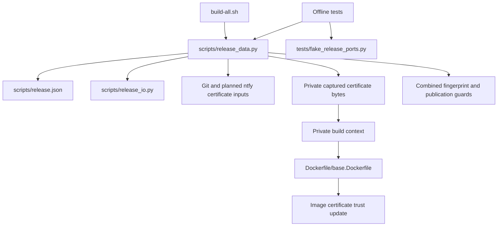

# Brooks-Lint Health Dashboard

- [Brooks-Lint Health Dashboard](#brooks-lint-health-dashboard)
  - [Dimension Scores](#dimension-scores)
  - [Module Dependency Graph](#module-dependency-graph)
  - [Test Suite Map](#test-suite-map)
  - [Top Findings](#top-findings)
  - [Evidence And Limits](#evidence-and-limits)
  - [Recommendation](#recommendation)

**Mode:** Health Dashboard

**Scope:** Plan readiness: `tasks/6-add-ntfy-ca-certificate/2-plan.md`, checked against `1-goal.md`, certificate capture, release identity, publication guards, private build contexts, Dockerfile trust installation, and related tests. This is not an implementation health assessment.

**Composite Score:** 100/100

**Trend:** Stable at 100 compared with the previous Health Dashboard entry. That entry reviewed branch implementation, so these scores do not establish an implementation trend.

**Verdict:** Approved for implementation. No blocking findings or required plan revisions.

## Dimension Scores

- Code Quality: 100/100. The planned changes address every existing certificate lifecycle stage and retain the Git input interface. Changes across configuration, policy, Dockerfile, tests, and documentation are coordinated work within one feature, not unrelated change propagation.
- Architecture: 100/100. Certificate selection, capture, fingerprinting, and revalidation remain in `release_data.py`. Shell orchestration and the HTTPS transport need no redesign. Sharing selection and fingerprint logic prevents initialization and guard behavior from drifting.
- Tech Debt: 100/100. A second explicit certificate input matches the concrete requirement without introducing a generic certificate framework. The combined fingerprint preserves release identity integrity, and the plan explicitly rejects adoption of old release evidence.
- Test Quality: 100/100. Distinct certificate bytes, exact context checks, invalid-input cases, mutation detection, snapshot isolation, and Dockerfile ordering protect the changed behavior. The plan distinguishes offline contract checks from native trust verification.

Balanced scoring applies. All four dimensions evaluate the proposed plan, including Code Quality rather than an implementation diff. No findings means no deductions: `100 × 0.25 + 100 × 0.30 + 100 × 0.25 + 100 × 0.20 = 100`.

## Module Dependency Graph

This is a responsibility and data-flow graph, not solely a Python import graph. Host HTTPS trust remains separate from certificate installation inside the image.

## Test Suite Map

- Existing isolated policy and transport tests: 39 test methods across `DataBoundaryTests` (11), `HttpDiagnosticsTests` (11), and `PackageEvidenceTests` (17).
- Existing subprocess integration tests: 47 test methods across `LocalContractTests` (15), `PublicationTests` (13), and `PackagePublicationTests` (19), using fake Git, Docker, and curl boundaries.
- Native end-to-end coverage: none in the inspected suite. These counts describe test methods, not parameterized cases or measured runtime.
- Planned additions appropriately split certificate selection, fingerprinting, and snapshot checks from whole-command build/publication outcomes. No real Docker or network access is needed for those checks.

## Top Findings

No Critical, Warning, or Suggestion findings. Important risks are already addressed explicitly: the private context must include both files; each input must affect identity; guards must reject either changed input; validation must not require external certificates; and old release evidence must not be rewritten.

## Evidence And Limits

- `scripts/release_data.py:151-158` currently captures and hashes only the Git certificate; `scripts/release_data.py:624-625` rechecks that source; `scripts/release_data.py:679-686` copies its capture into the context. The plan covers all three paths.
- `scripts/release_data.py:303-309` and `scripts/release_data.py:569-573` consume the certificate fingerprint through labels and annotated release identity. Retaining those consumers while extending the fingerprint binds both inputs without adding another identity mechanism.
- `Dockerfile/base.Dockerfile:4-18` copies the Git CA before `update-ca-certificates`. Adding the ntfy copy alongside it fits the current installation order.
- `tests/fake_release_ports.py:145-149` currently accepts only the Git certificate and Dockerfile directory. Updating its exact inventory is necessary, not incidental test brittleness: the context is the Docker build input and must exclude credentials.
- No `.brooks-lint.yaml` exists; default risks and balanced scoring apply. R1–R6 and T1–T6 were considered within plan scope, with no evidence requiring a finding. No implementation changes, test execution, native builds, certificate installation, or live service checks occurred.
- The earlier question about curl's `--insecure` option did not request a plan change. TLS bypass and notification configuration remain outside this task's implementation scope.

## Recommendation

Implement the plan as written. Keep certificate lifecycle logic shared and small, update the fake context contract with distinct input bytes, and run the specified offline checks. A later native build or ntfy connectivity check needs separate authorization and valid certificates; this review does not certify live HTTPS trust.
