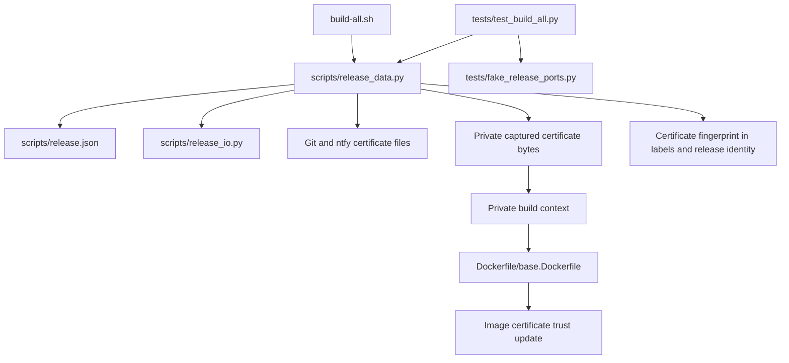

# Brooks-Lint Health Dashboard

- [Brooks-Lint Health Dashboard](#brooks-lint-health-dashboard)
  - [Dimension Scores](#dimension-scores)
  - [Module Dependency Graph](#module-dependency-graph)
  - [Test Suite Map](#test-suite-map)
  - [Top Findings](#top-findings)
  - [Verification And Limits](#verification-and-limits)
  - [Recommendation](#recommendation)

**Mode:** Health Dashboard

**Scope:** All 10 changed files on `6-add-ntfy-ca-certificate`, comparing local base `main` (`c6f1c55`) with implementation `19b18c7`. Includes Dockerfile, README, version, release configuration and documentation, certificate policy, test fixtures, regression tests, and implementation results. Planning documents already exist on the base branch and are context, not branch changes.

**Composite Score:** 100/100

**Trend:** Stable at 100 compared with the previous Health Dashboard entry. That entry assessed plan readiness, not implementation, so this is not a measured code-quality trend.

**Verdict:** Approved. No blocking findings or implementation fixes identified within the branch scope.

## Dimension Scores

- Code Quality: 100/100. `certificates()` centralizes bounded input selection and sanitized failures; `certificate_fingerprint()` keeps deterministic hashing separate. Initialization, guards, and snapshots consistently use the same two-certificate contract. The change does not add nested orchestration or unrelated responsibilities.
- Architecture: 100/100. Certificate lifecycle policy stays in `release_data.py`; bounded reading and canonical serialization remain in `release_io.py`. Shell orchestration and HTTPS transport are unchanged. The dependency direction remains acyclic, and image trust stays separate from host trust.
- Tech Debt: 100/100. The explicit two-entry certificate mapping serves the current requirement without speculative configuration machinery. Git's interface remains supported, while ntfy has its own documented override. Both filenames and contents affect the existing identity consumers; old release evidence is not silently adopted.
- Test Quality: 100/100. New cases cover selection, empty overrides, home expansion, invalid inputs, sanitized errors, fingerprint sensitivity, guard refusals, captured-byte isolation, and Dockerfile ordering. Fake builds verify both distinct certificate contents. Exact context inventory assertions protect the build input and credential boundary rather than irrelevant implementation details.

Balanced scoring applies across all four dimensions. No findings means no deductions: `100 × 0.25 + 100 × 0.30 + 100 × 0.25 + 100 × 0.20 = 100`.

## Module Dependency Graph

This graph shows runtime responsibilities and data flow as well as module dependencies. No new production import or cycle is introduced.

## Test Suite Map

- Isolated policy and transport tests: 46 methods across `DataBoundaryTests` (18), `HttpDiagnosticsTests` (11), and `PackageEvidenceTests` (17).
- Subprocess integration tests: 48 methods across `LocalContractTests` (16), `PublicationTests` (13), and `PackagePublicationTests` (19), with fake external service boundaries.
- Native end-to-end tests: none in the inspected suite. Counts exclude parameterized subcases.
- The branch adds eight test methods and extends existing fixtures and integration assertions. Focused unit-level checks cover certificate edge cases; command-level tests cover cleanup, no-write refusals, local builds, publication, and completed retries. No test-pyramid finding is inferred from counts alone.

## Top Findings

No Critical, Warning, or Suggestion findings. The lightweight scans considered R1–R6 and test clarity/brittleness, with change-path coverage checked against the reviewed plan. Coordinated changes to Dockerfile, configuration, policy, tests, and docs belong to one certificate feature and are not unrelated change propagation.

## Verification And Limits

- Review rerun: 23 tests passed in 51.514 seconds, covering all `DataBoundaryTests`, invalid-certificate refusal and cleanup, caller-relative inputs, validation without certificates, two-image local builds, and publication with read-only completed retries.
- Review checks: `bash -n build-all.sh`, `bash build-all.sh --validate`, and `git diff main...HEAD --check` passed.
- Prior implementation verification: the complete 94-test suite passed in 492.682 seconds, as recorded in `4-implemented.md` and the implementation session. The complete suite was not rerun during this review.
- Inspected `scripts/release_data.py:156-179`, `641-645`, and `699-707`: both inputs are captured before builder operations, bounded independently, fingerprinted by filename and content, rechecked by publication guards, and copied from captures rather than live inputs.
- Inspected `Dockerfile/base.Dockerfile:4-19`: both CA copies precede the existing trust update. `VERSION`, configured notes path, and the release heading consistently identify `0.1.5`.
- No `.brooks-lint.yaml` exists; default risks and balanced scoring apply. No implementation files were modified during review.
- Fake certificate bytes and fake Docker commands do not establish actual CA validity, native image trust installation, ntfy connectivity, or registry readiness. No live builds, host certificate installation, TLS bypass, or remote publication occurred.

## Recommendation

The branch is ready for the next repository workflow stage without code fixes. Provide both valid CA inputs before a separately authorized native build; retain host HTTPS verification and the existing release-conflict safeguards. Offline approval does not certify live ntfy connectivity or publication readiness.
