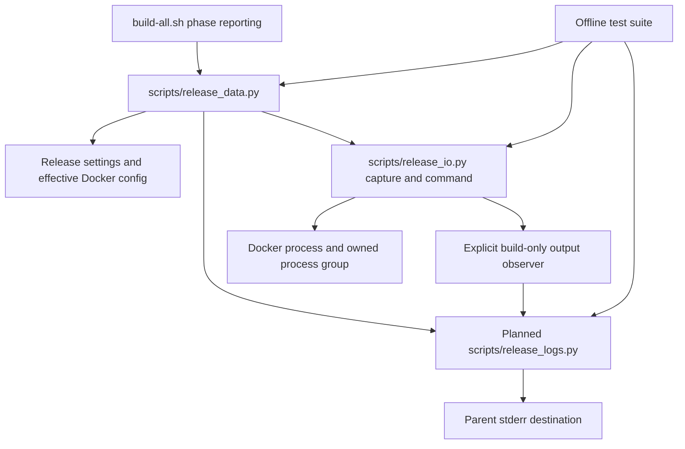

# Brooks-Lint Health Dashboard

- [Brooks-Lint Health Dashboard](#brooks-lint-health-dashboard)
  - [Dimension Scores](#dimension-scores)
  - [Module Dependency Graph](#module-dependency-graph)
  - [Test Suite Map](#test-suite-map)
  - [Top Findings](#top-findings)
    - [Warning](#warning)
  - [Evidence And Limits](#evidence-and-limits)
  - [Recommendation](#recommendation)

**Mode:** Health Dashboard

**Scope:** Plan readiness: `tasks/7-display-build-logs/2-plan.md`, checked against `1-goal.md`, subprocess capture, credential and Docker configuration handling, shell orchestration, release identity, and existing tests. This score assesses the proposed design, not implemented logging behavior.

**Composite Score:** 98/100

**Trend:** Previous Health Dashboard score: 100; current score: 98 (-2). The previous entry reviewed a different branch implementation, so this is not a codebase regression measurement.

**Verdict:** Revise the plan before implementation to address two Warning findings. No Critical findings.

## Dimension Scores

- Code Quality: 100/100. An explicit observer preserves default capture behavior; stderr-only progress avoids corrupting helper stdout. No code-quality finding is inferred from the length of this plan.
- Architecture: 95/100. The logging component has a coherent responsibility and no proposed dependency cycle, but synchronous writes to an external output sink can couple presentation backpressure to process supervision (finding 1).
- Tech Debt: 100/100. The plan preserves generic command privacy, publication authority, script hashing, and documented limits without adding a raw-log escape hatch. The additional filter is justified by the existing credential/privacy contract rather than a speculative framework.
- Test Quality: 95/100. The handshake, failure, cleanup, chunk-boundary, and machine-output tests are well targeted. Docker auth coverage leaves a concrete encoded-versus-decoded credential case unspecified (finding 2).

Balanced deductions apply once per finding in its owning dimension. Composite: `100 × 0.25 + 95 × 0.30 + 100 × 0.25 + 95 × 0.20 = 97.5`, rounded half-up to 98. Code Quality evaluates the proposed changes rather than an implementation diff.

## Module Dependency Graph

The diagram combines module dependencies and runtime data flow. The observer must not import release policy into the generic runner. The unresolved boundary is whether the stderr destination can block the loop responsible for draining and terminating Docker.

## Test Suite Map

- Existing isolated policy and transport coverage: 46 test methods across `DataBoundaryTests` (18), `HttpDiagnosticsTests` (11), and `PackageEvidenceTests` (17).
- Existing subprocess integration coverage: 48 test methods across `LocalContractTests` (16), `PublicationTests` (13), and `PackagePublicationTests` (19), using fake external service boundaries.
- Native end-to-end coverage: none in the inspected suite. Counts describe methods, not subcases or measured coverage percentages.
- Planned additions appropriately separate filter/capture tests from whole-command progress, build failure, reuse, and completed-retry tests. Add the two cases below without duplicating all existing publication scenarios.

## Top Findings

### Warning

**1. R2 Change Propagation — A blocked log sink can stall process supervision (Architecture)**

Symptom: `2-plan.md:23-28` adds a display observer to the selector-driven capture loop and requires immediate stderr writes and flushes. It covers a failing sink but does not specify bounded behavior for a sink that stays open without accepting more bytes. In the existing runner, deadline checks and both child-pipe reads run on that same loop (`scripts/release_io.py:98-119`).

Source: The Pragmatic Programmer — Orthogonality; Code Complete — defensive programming and explicit failure handling.

Consequence: Redirecting output to a full pipe or stalled consumer can block a synchronous write indefinitely. The runner then stops draining Docker stdout/stderr and cannot perform its normal deadline checks, violating the plan's preserved timeout and cleanup guarantees even though no write exception occurs.

Remedy: Define a bounded sink/backpressure policy before implementation. Keep sink writes out of the child-read/deadline critical path through a bounded, supervised mechanism, or explicitly stop the operation when safe delivery cannot proceed within a fixed deadline. Do not rely on an unbounded queue or a writer that cannot be shut down. Add a real-process test with an open, deliberately undrained stderr destination that fills, proving bounded memory, timely refusal, and owned-process cleanup; a mocked broken pipe alone is insufficient.

**2. T5 Coverage Illusion — Docker auth tests do not distinguish encoded credentials from decoded passwords (Test Quality)**

Symptom: `2-plan.md:34` names Docker `auths` credential values and the current login/token Basic encoding, while `2-plan.md:52` requires a generic Docker-auth redaction test. Neither explicitly requires deriving a different registry password from an `auth` entry containing Base64 `username:password`. The existing unrelated-registry fixture uses the placeholder `foreign-auth` (`tests/test_build_all.py:298`), which cannot characterize this distinction. Structured assignment suppression would not catch a bare decoded password in an ordinary error sentence.

Source: The Art of Unit Testing — completeness of edge-path tests; How Google Tests Software — change coverage rather than superficial execution coverage.

Consequence: An implementation could redact only the encoded config value and still pass the stated generic auth test while displaying its decoded password. This is a standard representation of an available known credential, not the arbitrary-secret or custom-encoding limitation already accepted by the plan, especially in build-only mode using the original Docker config.

Remedy: Specify bounded extraction of supported Docker credential forms, including validated Base64 `auth` entries and their decoded password components, plus supported identity-token fields. Define sanitized refusal behavior for malformed supported entries without invoking external credential helpers or weakening publication auth isolation. Add a valid synthetic entry whose password differs from the release token; emit its encoded value and bare decoded password inside normal records, split across reads, and assert both are absent while useful surrounding text survives. Retain the explicit limitation for unknown credentials and custom transformations.

## Evidence And Limits

- The plan correctly identifies `capture()` and `command()` as the reason Docker output is hidden and limits observer activation to actual builds, not promotion or authenticated API reads.
- `build-all.sh:60-98` captures helper decisions in command substitutions and shares the build action with alias promotion. Keeping all new display output on stderr and checking the exact Docker operation are necessary safeguards already present in the plan.
- `scripts/release_data.py:188-209` demonstrates the distinction between the raw private token and its Basic-auth encoding. `docker_auth()` deliberately drops unrelated registry auth for publication; the new redaction preparation must not undo that isolation or call credential helpers.
- The planned addition of the logging module to the script fingerprint addresses `settings()`'s current explicit three-file hash inventory. The README/docs/version work matches the repository's release convention.
- No `.brooks-lint.yaml` exists; default risks and balanced scoring apply. The abbreviated scans considered R1–R6 and T1–T6 within plan scope, without treating suite ratios, coordinated feature edits, or explicit security limitations as automatic defects.
- No implementation code or plan content was changed. No tests, live Docker builds, service probes, login, or publication were run for this document-only review. Findings describe design and verification gaps, not reproduced defects in a logging implementation that does not yet exist.

## Recommendation

Update `2-plan.md` to define bounded output delivery and supported Docker credential decoding, with the two concrete regression scenarios above. Preserve the rest of the plan's boundaries: default-visible filtered build output, private API/other command output, machine-readable stdout, process limits, and unchanged release mutation authority. No broader architecture redesign is needed.
