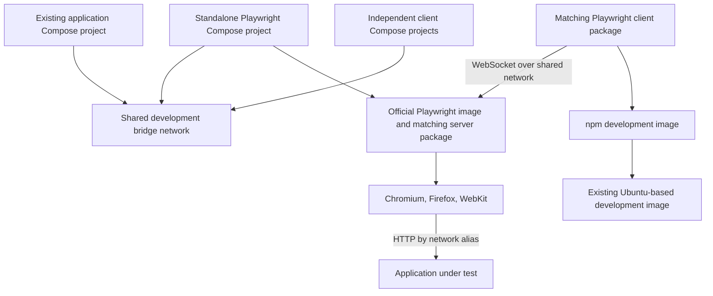

# Brooks-Lint Health Dashboard

- [Brooks-Lint Health Dashboard](#brooks-lint-health-dashboard)
  - [Dashboard](#dashboard)
  - [Module Dependency Graph](#module-dependency-graph)
  - [Test Suite Map](#test-suite-map)
  - [Top Findings](#top-findings)
    - [Warning](#warning)
    - [Suggestion](#suggestion)
  - [Recommendation](#recommendation)
  - [Verification Limits](#verification-limits)

**Mode:** Health Dashboard

**Scope:** Plan readiness for `tasks/8-use-official-images/2-plan.md` at commit `8a01f34`, checked against current Dockerfiles, Compose configuration, tests, and the user's latest request. This is not an implementation health score.

**Composite Score:** 98/100

**Trend:** Previous Health Dashboard score was 99 for a different implementation scope; this result is not a comparable regression measurement.

The plan correctly separates remote browsers from client containers and preserves the existing base and OpenCode setup, but should define readiness before implementation.

## Dashboard

- Code Quality: Not scored; no implementation diff exists. The reviewed changes are planning documents.
- Architecture: 95/100; one Warning for a missing readiness contract between independent Compose projects.
- Tech Debt: 100/100; no additional actionable findings within this plan's scope. Version alignment is intentional protocol coupling, and the plan already requires consistency checks.
- Test Quality: 99/100; one Suggestion for an omitted version-mismatch failure scenario.
- Balanced deductions: Warning minus 5; Suggestion minus 1. With Code Quality skipped, the weighted score is `(95 × 0.30 + 100 × 0.25 + 99 × 0.20) / 0.75 = 97.733…`, rounded half-up to 98.
- Configuration: No `.brooks-lint.yaml` exists; default balanced settings apply. No Critical findings.

## Module Dependency Graph

The graph describes the proposed design, not running containers. Compose owns network configuration; the browser server owns browser executables. Client code owns test execution. No dependency cycle or OpenCode migration is proposed.

## Test Suite Map

- Existing declared test methods: 47 in `tests/test_build_all.py`, 26 in `tests/test_build_logs.py`, 11 in `tests/test_http_diagnostics.py`, and 36 in `tests/test_package_release.py`; 120 total by static AST inspection, not test collection or execution.
- Unit coverage includes configuration/evidence validation, HTTP diagnostics, and log filtering. Integration coverage includes real local subprocess streaming and release orchestration against fake Git/Docker/HTTP boundaries. Several files mix these layers; a precise per-layer execution count was not measured.
- No dedicated existing Playwright browser-server end-to-end tests were located. Existing release tests do not demonstrate remote browser behavior.
- Planned coverage appropriately combines offline configuration assertions, Compose validation, two independent clients, all three browser engines, application alias routing, and an unattached-client check. Browser tests remain explicitly separate from the offline release suite.

## Top Findings

### Warning

**W1 — R5: Dependency Disorder — Startup order lacks a readiness contract**

- Symptom: `2-plan.md:33` permits a cold `npx` package download; `2-plan.md:48` only requires starting the server before clients. No bounded readiness probe, retry policy, startup timeout, or failure diagnostic is specified. Independent Compose projects cannot rely on a cross-project `depends_on` condition.
- Source: *Clean Architecture* — explicit dependency boundaries; *Code Complete* — defensive error handling. Network existence and process creation are not the browser service's usable interface.
- Consequence: Clients can resolve `playwright` and still fail with connection refusal while the package downloads or the server starts. A failed package fetch can leave users waiting for a server that will never become ready, despite following the documented startup order.
- Remedy: Specify a server health/readiness check and a bounded client-side connection wait, with a concrete timeout and actionable failure output. Use a meaningful probe for the selected server version, not merely network existence. Document a startup command that waits for readiness and how independent clients handle an unavailable server. Add a delayed-start and failed-start smoke scenario without silently falling back to local browser launch.

### Suggestion

**S1 — T5: Coverage Illusion — Version alignment lacks a runtime rejection check**

- Symptom: `2-plan.md:55` requires offline equality checks for image/server/client versions, and `2-plan.md:59-60` tests matching clients. It does not exercise a downstream client with a deliberately incompatible version, although `2-plan.md:77` identifies independently maintained client versions as a risk.
- Source: *The Art of Unit Testing* — test completeness; *How Google Tests Software* — change coverage rather than nominal coverage.
- Consequence: Repository configuration can pass every equality assertion while an external client fails with an undocumented protocol/version error. Users may misdiagnose the failure as Docker DNS or shared-network configuration.
- Remedy: Include one deliberate incompatible-client smoke check using a known incompatible supported test pair. Verify bounded failure and record the actual diagnostic or troubleshooting guidance. Keep it outside the offline unit suite; do not assert brittle exact upstream error wording.

## Recommendation

Resolve W1 in the plan before implementation. S1 is a useful optional addition to the runtime checklist. Keep the chosen design: a standalone official Playwright server, matching client packages without local browsers, a shared external network, and unchanged base/OpenCode setup. No broader architecture rewrite or additional service abstraction is needed.

## Verification Limits

Reviewed the task goal and plan, current Dockerfiles and Compose file, representative release/log tests, and history. Inspected test method counts statically. The original goal is outdated, but the plan explicitly supersedes it and matches the user's latest direction; this is not treated as a scope blocker. No implementation files or plan content were changed. No test suite, image pull, build, server startup, browser execution, or network mutation was performed during this review. Upstream image/package availability and browser runtime behavior remain implementation gates, as the plan already states.
