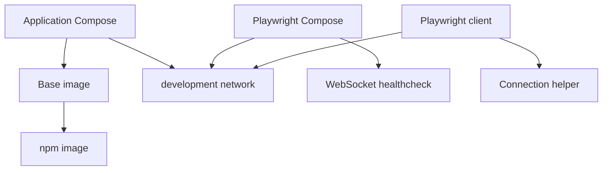

# Brooks-Lint Health Dashboard

- [Brooks-Lint Health Dashboard](#brooks-lint-health-dashboard)
  - [Module Dependency Graph](#module-dependency-graph)
  - [Top Findings](#top-findings)
    - [Warning](#warning)
  - [Test Suite Map and Verification](#test-suite-map-and-verification)
  - [Recommendation](#recommendation)

**Mode:** Health Dashboard
**Scope:** Branch `8-use-official-images` at `169aa6b` against `main` at `5f291d1`; 16 changed files.
**Composite Score:** 99/100
**Scores:** Code Quality 100/100; Architecture 100/100; Tech Debt 100/100; Test Quality 95/100. Balanced deductions and weights 25%, 30%, 25%, and 20%, respectively. Scores describe only the reviewed branch changes, not the whole project.

The focused regression suite fails on an intentionally removed port, and the implementation record does not describe the final OpenCode changes.

## Module Dependency Graph

## Top Findings

### Warning

**Coverage Illusion (T5) — Verification record predates the final base and port changes**

Symptom: `tests/test_playwright.py:54` still requires port 4096 and currently fails, although its removal is intentional. `tasks/8-use-official-images/4-implemented.md:25-31` reports passing checks and unchanged base behavior, but subsequent branch commits changed both files; its runtime check used an existing base image.

Source: *How Google Tests Software* — Change coverage; *Working Effectively with Legacy Code* — Characterization Tests.

Consequence: The recorded successful runs do not describe the final intentional OpenCode removal, and the current offline suite is red.

Remedy: Update the obsolete port assertion and documentation to reflect the intentional OpenCode changes, rerun verification after the final changes, and update the implementation record with actual results and remaining build limitations.

## Test Suite Map and Verification

Changed tests comprise five Python offline configuration tests, ten Node behavioral tests, and one opt-in Docker integration smoke runner covering multiple scenarios. Existing release tests also remain in scope for regression checks.

- `python3 -B -m unittest discover -s tests -p test_playwright.py -v`: four passed, one failed on the missing port mapping.
- Full Python discovery was stopped by the 120-second command timeout before completion; no full-suite result is claimed.
- `node --test tests/test_playwright.cjs` could not run because `node` is not installed in this environment.
- `git diff --check main...HEAD` passed. Fresh image builds and Docker smoke tests were not run during this review.
- The prior implementation record documents further runtime checks, but they precede the final base and Compose changes and cannot validate those changes.

## Recommendation

Update the obsolete port assertion and documentation to reflect the intentional removal of the OpenCode server and port. Rerun the focused and full suites against the final branch, followed by fresh-image runtime verification when build prerequisites are available. Test Quality needs the most follow-up; a focused test review may help assess the remaining coverage.
