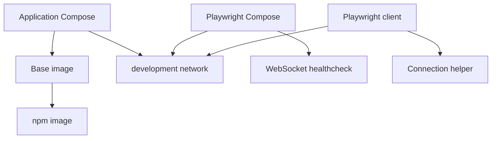

# Brooks-Lint Health Dashboard

- [Brooks-Lint Health Dashboard](#brooks-lint-health-dashboard)
  - [Module Dependency Graph](#module-dependency-graph)
  - [Top Findings](#top-findings)
    - [Critical](#critical)
    - [Warning](#warning)
  - [Test Suite Map and Verification](#test-suite-map-and-verification)
  - [Recommendation](#recommendation)

**Mode:** Health Dashboard
**Scope:** Branch `8-use-official-images` at `169aa6b` against `main` at `5f291d1`; 16 changed files.
**Composite Score:** 96/100
**Scores:** Code Quality 85/100; Architecture 100/100; Tech Debt 100/100; Test Quality 95/100. Balanced deductions and weights 25%, 30%, 25%, and 20%, respectively. Scores describe only the reviewed branch changes, not the whole project.

The branch is not ready to merge: the existing OpenCode startup contract changed, and the focused regression suite fails on an intentionally removed port.

## Module Dependency Graph

## Top Findings

### Critical

**Change Propagation (R2) — Base image no longer starts the authenticated OpenCode server**

Symptom: `Dockerfile/base.Dockerfile:9-12` removes `OPENCODE_SERVER_PASSWORD`, and the file ends at line 31 without the previous `opencode serve --hostname 0.0.0.0 --port 4096` command. Both the base and npm images inherit this change. The plan explicitly requires preserving startup and authentication.

Source: *Software Engineering at Google* — Backward compatibility.

Consequence: Newly built images no longer provide the previously automatic OpenCode server. Explicitly starting a server also no longer receives the previous password by default, potentially exposing an unauthenticated service if bound externally.

Remedy: Restore the original server command and authentication contract, and verify both freshly built images start the authenticated server.

### Warning

**Coverage Illusion (T5) — Verification record predates the final base and port changes**

Symptom: `tests/test_playwright.py:54` still requires port 4096 and currently fails, although its removal is intentional. Its base-image checks at lines 27-30 do not verify the original command or password. `tasks/8-use-official-images/4-implemented.md:25-31` reports passing checks and unchanged base behavior, but subsequent branch commits changed both files; its runtime check used an existing base image.

Source: *How Google Tests Software* — Change coverage; *Working Effectively with Legacy Code* — Characterization Tests.

Consequence: The recorded successful runs do not establish that the final branch preserves startup or authentication, and the current offline suite is red.

Remedy: Add explicit regression coverage for the base command and authentication, update the obsolete port assertion, rerun verification after the final changes, and update the implementation record with actual results and remaining build limitations.

## Test Suite Map and Verification

Changed tests comprise five Python offline configuration tests, ten Node behavioral tests, and one opt-in Docker integration smoke runner covering multiple scenarios. Existing release tests also remain in scope for regression checks.

- `python3 -B -m unittest discover -s tests -p test_playwright.py -v`: four passed, one failed on the missing port mapping.
- Full Python discovery was stopped by the 120-second command timeout before completion; no full-suite result is claimed.
- `node --test tests/test_playwright.cjs` could not run because `node` is not installed in this environment.
- `git diff --check main...HEAD` passed. Fresh image builds and Docker smoke tests were not run during this review.
- The prior implementation record documents further runtime checks, but they precede the final base and Compose changes and cannot validate those changes.

## Recommendation

Resolve the unintended base image startup and authentication changes first; keep port 4096 removed as requested. Then add startup contract coverage and rerun the focused and full suites against the final branch, followed by fresh-image runtime verification when build prerequisites are available. Test Quality needs the most follow-up; a focused test review may help assess the remaining coverage.
