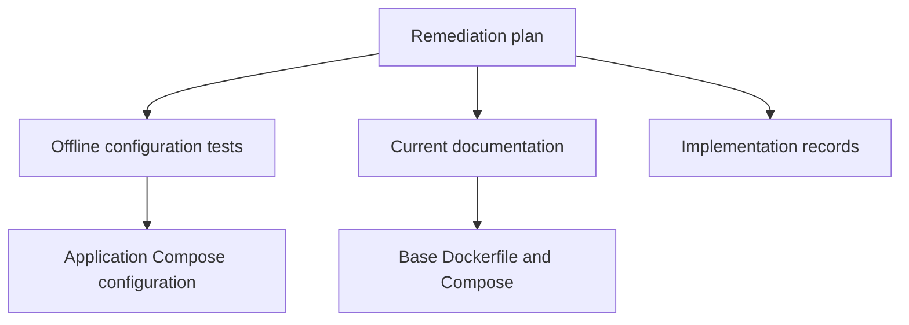

# Brooks-Lint Health Dashboard

- [Brooks-Lint Health Dashboard](#brooks-lint-health-dashboard)
  - [Module Dependency Graph](#module-dependency-graph)
  - [Top Findings](#top-findings)
    - [Warning](#warning)
  - [Test Suite Map](#test-suite-map)
  - [Recommendation](#recommendation)

**Mode:** Health Dashboard
**Scope:** Plan readiness for `tasks/9-fix-review-warning/2-plan.md` at `e536c8d`; not an implementation review.
**Composite Score:** 99/100
**Scores:** Code Quality 100/100; Architecture 100/100; Tech Debt 100/100; Test Quality 95/100. Balanced scoring; weights 25%, 30%, 25%, and 20%.

The plan addresses the review warning and preserves the intentional removal, but its proposed port regression check can miss equivalent mappings.

## Module Dependency Graph

This graph describes the proposed documentation and test dependencies, not runtime changes.

## Top Findings

### Warning

**Coverage Illusion (T5) — The proposed port check can pass with port 4096 still published**

Symptom: `tasks/9-fix-review-warning/2-plan.md:25` asks only for the `4096:4096` mapping to be absent. Compose can publish the same container port with a different host port or long syntax without containing that literal. The existing tests in `tests/test_playwright.py` read raw text rather than normalized Compose configuration.

Source: *How Google Tests Software* — Change coverage.

Consequence: A future publication of the removed OpenCode port could pass the planned regression check, providing false confidence in the stated removal.

Remedy: Define the intended contract explicitly and verify it at the appropriate level. If no application ports should be published, assert the app service has no `ports` configuration; otherwise inspect normalized Compose configuration for published target port 4096. Retain a dependency-free offline check and add a Compose configuration check when available, including a representative alternative mapping as a negative test.

## Test Suite Map

The affected suite contains five Python offline configuration tests, ten Node behavioral tests, and an opt-in Docker smoke runner. The plan proposes focused and full Python runs, Node tests when available, Compose validation, and optional fresh-image checks. These are planned checks, not results from this review.

## Recommendation

Clarify and strengthen the port regression contract before implementation. The architecture and documentation scope otherwise fit the goal. A focused test-quality review is optional if broader test coverage is needed.
