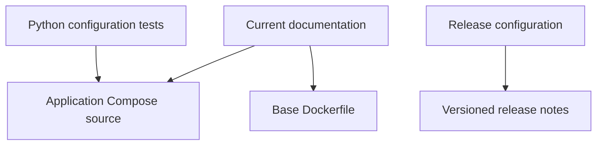

# Brooks-Lint Health Dashboard

- [Brooks-Lint Health Dashboard](#brooks-lint-health-dashboard)
  - [Module Dependency Graph](#module-dependency-graph)
  - [Top Findings](#top-findings)
    - [Warning](#warning)
  - [Test Suite Map and Verification](#test-suite-map-and-verification)
  - [Recommendation](#recommendation)

**Mode:** Health Dashboard
**Scope:** `9-fix-review-warning` at `5976ee1` against its parent branch `8-use-official-images` at `ec2a214`; 10 changed files.
**Composite Score:** 99/100
**Scores:** Code Quality 100/100; Architecture 100/100; Tech Debt 100/100; Test Quality 95/100. Balanced scoring; weights 25%, 30%, 25%, and 20%. Scores cover the branch changes, not the whole project.

The documentation correction is appropriate, but the new offline port regression check does not reliably enforce its stated contract.

## Module Dependency Graph

## Top Findings

### Warning

**Coverage Illusion (T5) — Port check can miss published target 4096 and reject unrelated ports**

Symptom: `tests/test_playwright.py:10-19` matches only an unquoted `ports:` key and treats any occurrence of `4096` in its block as a prohibited target. A valid quoted `"ports":` key with `"8080:4096"` returns false, while `"4096:8080"` returns true even though its target is 8080. The normalized Compose check documented in `tasks/9-fix-review-warning/4-implemented.md:18` was a one-time verification, not a persistent regression test.

Source: *How Google Tests Software* — Change coverage; *xUnit Test Patterns* — Erratic Test and test intent.

Consequence: The suite can pass when target 4096 is published and fail when an unrelated target is published on host port 4096. This contradicts the planned contract that permits other ports and undermines future regression detection.

Remedy: Check the actual published target using normalized Compose configuration in a repeatable test when Compose is available. Make the offline check explicitly fail closed on unrecognized port syntax or otherwise correctly distinguish host from target. Add fixtures for a quoted key and `4096:8080`, as well as the existing short and long target-4096 cases.

## Test Suite Map and Verification

The changed Python suite includes six offline Playwright configuration tests. The existing Node behavioral tests and opt-in Docker integration runner were not modified. The implementation record reports 126 Python tests passed, Compose validation passed, and fresh-image checks blocked by certificate access; Node was unavailable.

This review independently exercised `app_source_has_4096_port` with the two fixtures above and confirmed both results. No fresh images or full suite were run during this review.

## Recommendation

Strengthen the port regression check before relying on it to protect the removal. Test Quality is the only dimension with a finding; a focused test review is optional.
